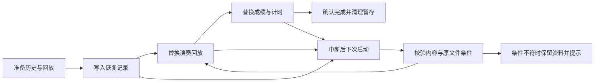

# 桌面练习室整合

2026-11-16：当前目标、逐项结论与停止条件统一迁入 [当前计划](current-plan.md)。本地日常练习候选版已按 `1f5cf57` 交付，最新证据与人工确认项见 [交付记录](r1-delivery.md)。本页保留按批次记录的实现和当轮检查；历史段落中的“下一步”“继续整理”按原日期理解。本轮自动开发结束，R2/R3 独立安排。

开始日期：2026-11-13。目标是将已有能力整合为可日常使用的 Windows 钢琴练习软件。
保留本地数据、现有功能和旧原生入口，分批保存可运行版本。

## 执行顺序

2026-11-16 已整合三个工作区的浏览接续：曲库、历史回顾及练习选曲分别暂存筛选、页码、选中项、详情分区与滚动位置，快捷返回在重启后保留；暂存延后合并，关闭前收齐，损坏分项保留原文并恢复其他位置。成绩只保存选择编号，重新读取当前详情与来源。曲库读齐后再调整页码，暂未找到的选择和查看位置继续保留，可重读、修复、逐项取消或复制完整清单；批量处理按路径去重并等待全部选择核对。缺失文件、待复习及快捷查找保留原列表和曲目范围，已打开曲库时也能接续快捷入口。列表、详情、日历、用时及学习证据离开后取消原读取；日历、用时、复习建议和文件修复补齐连接范围。源码开发与整合约 31 分钟；前端类型检查修正浏览选项的字面量推断后通过。未运行自动化测试、浏览器、桌面或实际重启验收，未打包、推送或更新安装版。跨窗口暂存、重启恢复、窄窗交互和真实设备留待集中运行确认，剩余整合与统一交付继续推进。

2026-11-16 已整合启动恢复与后台取消：键盘连接和音源读取并行，设备故障分别提示；曲目跳过、恢复失败、附加资料和替代位置提供独立恢复项，可重新打开、核对原文件位置或进入曲库。重新定位按内容身份恢复标注，明确沿用已有资料和未启用旧谱面的情况；原位置保留在请求内，旧 JSON 与请求指纹兼容。曲目读取、技术练习、MusicXML 演奏生成、谱面对齐、声音事件整理与谱面版本打开加入分段取消；单侧缺失的音高匹配省去空矩阵，迟到跳过的大对象在后台释放。启动恢复类型由原生生成，历史提示与当前恢复状态分开显示，曲目安装成功后才报告位置恢复。源码开发与整合累计约 31 分钟；前端类型检查通过，Rust 修复共享音轨遍历错误并随提示边界修正复查通过，保留兼容入口等未使用代码警告。未运行自动化测试、浏览器、桌面、实际重启或键盘声音验收，未打包、推送或改动安装版；剩余后台边界、工作区打磨及集中交付继续推进。

2026-11-16 普通 MIDI／MusicXML 导入改为先入曲库，原生协议版本 4 区分曲库导入与旧曲目切换；后台处理保留当前演奏、录音及成绩，仅在用户打开结果时切换曲目。文件、附加标注、曲库索引与提交凭据共用可恢复事务，取消边界移到实际提交前；并发修改重新准备，保护已改动原件并保留谱面名称。谱面登记合并当前设置根，等待实际保存回复；文件已提交而登记中断时，可按原请求接续，重启后读取提交凭据并核对登记结果。长批次分段刷新曲库，缓存版本阻止旧回复覆盖新结果，打开结果统一由应用处理。源码开发与集成约 31 分钟；仅前端类型检查及 Rust 引擎编译各一次通过，保留已有未使用代码警告。未运行自动测试、浏览器、桌面、真实键盘声音或实际中断恢复验收，未打包、推送或修改安装版。后续继续整合剩余后台任务与状态边界、打磨三个工作区，并集中交付。

2026-11-16 已整合普通导入队列与直接打开：队列名称、内容指纹、原请求、完成结果、速度原文及浏览位置独立暂存，保护无法读取的原记录；任务归队列管理，关闭导入窗口后继续，可在主界面查看和暂停。重启后可单项或批量补选原文件，按名称、大小与内容指纹核对；已传完的文件可直接接续原请求。原生 MIDI、乐谱、技术练习和曲目包的接收、准备及最终回执保存到固定结果目录，内存淘汰或重启后可只读核对；中断传输明确结束，未知提交保留待核对，重复请求核对准备条件。桌面传输与回执读写移出窗口线程。直接打开保留本地 MIDI 附加标注与原谱来源，接入持久打开；已导入曲目和曲目包共用打开流程，可从回顾工作区返回练习。导入窗口增加概况、分页、原文件补选和完整提示；参数及回执不一致时保护原文。批量 MIDI／乐谱与原谱打开使用简短结果，导入时省去多余整曲及谱面回复。源码开发与集成约 31 分钟，前端类型、导入样式语法及 Rust 服务／桌面编译各一次通过；未运行测试、浏览器、桌面、实际重启恢复或键盘声音验收，未打包、推送或更新安装版。剩余整体打磨与集中交付继续推进。

2026-11-16 已整合日常选曲与队列续练：练习侧栏分为全部、收藏、最近及队列，支持搜索、来源、分页、键盘定位与滚动位置保留；新增队列条，继续下一首前保存有效练习，缺失文件可返回定位。侧栏、最近练习与队列共用持久打开流程，接续结果返回原工作区；重新定位先核对 MIDI 内容，在同一后台事务中恢复附加信息并安装曲目，复用已解析内容。准备时保留暂停及松键，拦住新发声、导入和重复打开；进度摘要去除重复更新，旧工作区的迟到错误忽略。源码开发与集成约 32 分钟，前端类型、三份样式语法及 Rust 服务／桌面编译各一次通过；未运行测试、浏览器、桌面或真实键盘声音验收，未打包、推送或更新安装版。剩余工作区打磨与集中交付继续推进。

2026-11-16：曲库打开已接入固定请求与持久结果，谱面与小节循环在同一事务中完成。历史与曲库共用原生回执和前端会话模块，保留旧格式；界面提供保留、取消、接续、重新打开、分页、复制及工作进度定位。复用选定谱面、减少完整曲目回复，纸谱逐页可取消，并处理背谱／完整演奏与看谱选段的模式冲突。源码推进约 31 分钟，前端类型、样式语法及 Rust 服务／桌面编译各一次通过；测试、实际运行及统一交付仍未执行。

2026-11-16：历史打开、指定小节、批阅和重练已接入独立请求回执。请求及入口先在界面暂存，后台固定编号防止重复执行，并核对提交时的当前练习状态；指定小节在原生事务内完成。结果与进度摘要分开持久保存，校验请求和内容，读进度使用摘要；接续完成后释放大结果并保留完成回执。原记录增加接续面板、保留操作列表、分页与复制，工作进度可返回原记录；界面离开、取消、回复中断和旧连接分别保留状态。暂存异常及未落盘的结果提示接入退出处理。源码推进约 31 分钟；类型、新样式语法和 Rust 服务／桌面编译各一次通过。未运行自动化测试、浏览器、桌面或设备验收，未打包、推送或更新安装版。下一步继续完成剩余工作区整合和集中交付；跨重启后的当前状态、真实声音与外部软件兼容性仍需运行验收。

2026-11-16：本轮已统一历史详情、演奏资料、回放与重练的来源版本。后台按练习条件和实际录音内容核对操作，返回准备完成的曲目及谱面版本；界面使用该结果接续批阅与定位。范围草稿、多个收藏草稿及撤销保留原录音版本，重新读取后保留秒数并提供核对入口。新收藏随记录保存录音版本，版本化收藏随格式 15 备份保留；旧收藏、旧备份及原生入口继续兼容。谱面可返回原演奏，迟到导航忽略已离开的界面；批阅计算加入取消检查。演奏、表达反馈、批阅及谱面目标类型由原生定义生成。源码开发与整合超过半小时；前端类型和 Rust 服务／桌面编译各一次通过。未运行测试、浏览器、桌面或设备验收，未打包、推送或更新安装版。历史切换回复中断后的持久续接、剩余工作区打磨和集中运行验收仍待完成。

2026-11-15：历史回放与收藏片段已接入按记录的持久输入、多草稿、保存回执与工作进度。选段开始发声前安装循环，保留旧原生接口；逐音收听、范围编辑、缓存读取和重练核对已衔接。源码推进超过半小时，类型／样式／Rust 编译检查通过。历史动作的演奏版本约束、实际界面与声音验收、统一交付仍需继续完成。

2026-11-15 已整合曲目学习、回顾评语与专项目标编辑。学习目标分为目标、练习证据和阶段变更，保留日期与数字原始输入、当前分区及提交条件；支持逐项合并、还原后撤销和按需读取证据。评语按演奏记录保留输入、编辑位置和保存回执，回复中断后只读核对实际评语，再按原条件重试或继续编辑。学习、评语和专项要求核对写入结束状态，评语写入计入退出等待；读取与写入分别处理。专项阈值清空后保留空白，练习计划共用原始输入及校验，冲突合并继续保留原文。评语结果直接投影到列表和详情，按评语搜索时更新筛选，较早读取保留后续确认的文字。学习类型由 Rust 生成，生成器支持结构展开，旧入口保留。源码开发与整合超过半小时；前端类型及 Rust 服务／桌面编译定点修正可空连接标识和写入登记作用域后通过，三份新增样式语法一次通过。未运行自动化测试、浏览器、桌面或设备验收，未打包、推送或更新安装版。

2026-11-15 已整合界面与按键设置：显示、电脑键盘、快捷键和命名布局归属统一保存模块，保留旧存储键及入口。读取异常保护原文，跨窗口更新保留当前输入；成组保存保留中断记录，可继续或回退。备份恢复及采用输入前保留原记录副本，副本可查看、复制和重新采用。设置拆为五个分区，增加提示预览、快捷键搜索与分组、逐项恢复默认键；新增默认键优先让出已有绑定。布局名称按方案暂存，删除可关闭续接后撤销；导入预览、恢复选择及准备好的导出内容可续接，导出回复未确认时保留原内容。保存问题、布局名称和未完成备份接入工作进度与退出处理；显示调整复用未变化的按键映射，输入文字时保留编辑快捷键。源码开发与整合超过半小时；前端类型检查修正一处异步锁泛型后通过，新增样式语法一次通过。未运行自动化测试、浏览器、桌面或设备验收，未打包、推送或更新安装版。

2026-11-15：逐音分手与小节网格已整合持久输入、提交回执、当前资料核对及工作进度续接。分手建议保留手工选择，范围变化按音符位置续接；撤销带版本核对，手跨度通过后台目录合并保存。小节编辑按拍号、短小节及预览分区，保留未完成输入与精度，相同网格保存保留成绩。读写观察和编辑写入登记已统一。源码推进约 32 分钟，类型、样式与 Rust 编译检查一次通过；实际界面、键盘声音及统一交付仍待完成。

2026-11-15：练习段落与速度阶梯已共用持久草稿、保存回执、参数转换与校验，列表支持分页、筛选和定位；回复不明的新建使用固定编号核对结果，后台目录写入纳入退出等待与读取代次。名称更新独立保留原设置与进度，输入续接接入工作进度。源码开发约 32 分钟，最小类型／样式／Rust 编译检查通过；实际界面与键盘声音验收、统一交付包仍待完成。

2026-11-15 已整合谱面管理、导入与版本使用：版本、添加与初稿、PDF 与图片分区保留当前工作；版本支持查找、筛选、分页和独立详情，名称及版本标签按曲目暂存并处理原文保护与并发改名。上传的 MusicXML／MXL 在后台保留独立副本，区分用户文件与转谱／识谱来源，可重开、重试保留和另存；初稿列表支持查找分页及同内容已登记提示。演奏顺序按经过分页，支持反复／局部筛选和指定经过定位，跨页保留正确经过次数，校对问题单独分页。使用谱面在后台核对 MIDI 内容、谱面指纹、谱面版本及完整顺序，旧原生调用保留。操作与版本目录归属曲目工作台，窗口关闭后保留处理状态，重开复用原读取；保存回执、目录失败及原谱部分读取失败分别反馈。缺失当前关联文件时可解除关联。源码开发与审查超过半小时；前端类型及两份样式语法检查通过，Rust 定点修复共享引用和导入错误转换后编译检查通过。未运行自动化测试、浏览器、桌面或设备验收，未打包、推送或更新安装版。

2026-11-15 已整合谱页阅读与位置编辑：标记和定位工具可收起，宽窗并排、窄窗上下显示，继续草稿恢复输入焦点。小节／音符框选按谱本独立暂存，可分页续接、保留原文并恢复；数值保留未完成输入，编辑时暂停自动翻页，继续跟随保留草稿。小节对应保存按旧对应、页序及谱面版本核对，音符位置与异步定位核对来源，阅读位置保存绑定连接。图片页复用解码结果，限制并发与缓存，翻页丢弃过期读取；页码提交后跳转，读取失败可原地重试，修复 PDF 后重新加载。纸谱练习段复用统一暂存与恢复，兼容原草稿，保留提交内容及回执；回复丢失时只读核对已保存段落，避免重复创建或重放设置。谱本管理、阅读器、共用类型与历史定位已拆分，旧入口保留。源码开发与审查超过半小时；前端类型修正一处区分问题后通过，四份样式语法及 Rust 服务／桌面编译检查通过。未运行自动化测试、浏览器、桌面或设备验收，未打包、推送或更新安装版。

2026-11-15 指法工作台已接入本机输入暂存与分区审阅：暂存推荐条件、固定手指与勾选位置，同次运行保留方案和页码，关闭后可从独立工作台继续；不同条件和资料版本分别保留，生成建议只作有界运行缓存，资料更新或重启后重新推荐。保存与撤销在发出前记录请求，确认回执和待读取状态独立保留；回复丢失时只读取实际指法并按当前标记重新推荐，避免重复撤销。窗口按推荐条件、建议与逐音、保存前核对组织，范围输入保留未完成文字，跨区定位恢复对应行，隐藏区域停止自有示范；持音工具与主推荐分别管理忙碌状态。音轨设置按曲目／谱面版本执行，历史指法定位复用已核对的当前曲目。整曲手别索引、比较与勾选数据、手位上下文分开缓存，移除示范更新中的重复扫描。源码开发与审查超过半小时；前端类型、两份样式语法、Rust 服务与桌面入口编译检查各一次通过。未运行自动化测试、浏览器、桌面或设备验收，未打包、推送或更新安装版。

2026-11-15 已整合练习计划与回顾重练的衔接：下一项直接准备后交接，轮数达到上限可保留进度继续；曲目打开后的界面读取失败进入会话恢复，重试沿用已经完成的准备步骤。计划窗口分为项目与目标、计划信息、添加与编排，窄窗切换列表和详情，恢复日期、搜索、页码及草稿分区；目标数值的未完成输入单独暂存，阶梯目标独立显示。计划与曲目搜索支持分页并缓存搜索文本；计划读取、来源读取与写入核对连接，模式和小节范围操作核对曲目与谱面版本。回顾保留直接进入主界面的入口，范围、界面读取或谱面定位失败可分别接续，已打开曲目继续保留。源码开发与审查超过半小时；前端类型检查修正一处阶段类型后通过，修改样式语法及 Rust 服务／桌面编译检查通过。未运行自动化测试、浏览器、桌面或设备验收，未打包、推送或更新安装版。

2026-11-15 曲库与历史回顾已接入共同的详情分区，主操作保持清晰，切换分区保留编辑内容与各自滚动位置。曲库分为概览与目标、乐谱、文件与资料，乐谱按需读取，各类写入状态分别归属；回顾分为成绩与小节、演奏回放、条件与趋势、备注，逐小节筛选与翻页按记录保留。逐音与错音反馈支持完整翻页，重练统一选择乐谱、纸谱或指法入口，停止回放后的操作核对当前记录与页面；缺少完整练习条件的旧记录仍可查看已有演奏。源码开发与审查超过半小时，前端类型与两份改动样式语法检查一次通过；未运行测试、浏览器、桌面或设备验收，未打包、推送或更新安装版。

2026-11-15：已整理日常练习工作区。播放控制、参数侧栏、循环输入与状态说明拆为独立模块；侧栏按练习参数、进阶设置、本轮记录组织，切页保留编辑草稿。主区保留完成结果与反馈入口，小窗口按实际可用宽高收起小节导航，恢复键盘导航及跳转后的焦点。速度、音量、位置滑块先保留拖动值，松开或按键结束后提交，来源改变时取消旧操作；循环范围使用实际生效的小节，修正快捷键把秒数当小节、无效草稿阻碍关闭循环和中途选段定位等问题。队列下一首跳过不可用文件并说明数量。源码开发与审查超过半小时；前端类型与三份修改样式的语法检查一次通过。未运行测试、浏览器、桌面或设备验收，未打包、推送或更新安装版。下一步继续整理曲库与回顾的页面密度和主要操作，实际界面效果与硬件体验仍待统一验收。

2026-11-15：本轮已整合存储恢复状态与退出确认。后台读取导入、成绩、设置和谱面恢复记录，缓存检查结果及读取错误；运行时保存完成、失败与退出确认使用缓存，旧原生／独立读取路径保留原行为。设置保存、本轮成绩和恢复问题分别管理，迟到回执按当前队列状态显示；原保存重试采用版本核对，并纳入退出等待。新增后台“重新核对保存状态”，解除临时访问故障后清除对应提示，已锁定的资料仍需启动恢复。已保存但尚未登记的轮次在恢复后处理一次，保持停止；退出时单独提示待登记进度。桌面退出等待写入和回执完成后，再区分保留恢复资料与放弃未保存内容的确认；完整说明可在界面重连后取回。被替换的保存快照、旧偏好／历史／谱面交后台释放，沿用原文件提交与回滚规则。源码开发与审查超过半小时；271 条命令的协议类型、前端类型和 Rust 桌面／服务编译检查一次通过。未运行测试、浏览器、桌面或设备验收，未打包、推送或更新安装版。下一步继续整理其他业务响应与前端状态归属，并集中打磨剩余控件和页面密度；运行、实弹和兼容性验收仍待完成。

2026-11-15：本轮已统一单轮评估与保存衔接。后台生成一份不可变评估，复用目标音计数、成绩和逐音力度／踏板证据；显示、历史保存、计划达标和速度阶梯沿用相同结果。分析完成即提供给界面，后续历史整理和写入继续后台进行；保存取消或失败后保留本轮身份，重试可复用已有分析。补存已结束轮次会登记练习进度并保持停止。手动保存先固定演奏再进入存储队列；计时片段和音色清单改为共享快照，旧汇总／历史／音色清单在后台释放。整曲扫描共用音轨索引，统计、条件识别和回放编码加入取消检查。反馈窗口支持等待与补存，核对引擎身份、资料版本并限制重复操作。源码开发与审查超过半小时；仅执行一次前端类型检查和一次 Rust 桌面／服务编译检查，均通过。未运行测试、浏览器、桌面或设备验收，未打包、推送或更新安装版。下一步继续收紧其余业务响应类型和前端状态归属；真实演奏、长期使用与外部软件兼容性仍需集中验收。

2026-11-15：本轮已整合设备读取与连接任务。输入、输出、VST3 分别在独立线程读取，支持分项刷新、慢读取状态与错误；单个端口失败保留可读项目，清单不完整时不据此断开键盘。输入连接按请求与实际安装分别确认，忽略连接前的旧清单；常规 MIDI 消息以内联数据传递。VST3 支持厂商子目录和安装别名，限制目录遍历并保留诊断。设备连接任务接入统一工作进度，关闭设置后保留状态和结果；取消与读取按引擎归属，过期回复不覆盖新连接。已结束或旧连接的提示可明确知晓。源码开发与审查超过半小时，前端构建通过；统一构建发现一处旧入口读取格式未同步，已定点修复，随后仅对桌面与服务执行 Rust 编译检查并通过。源码提交为 c58e11f、18e2f69。本轮未运行测试、浏览器、桌面或硬件验收，未完成最终链接、未打包或更新安装版、未推送 GitHub。

2026-11-15：交付流程已接入统一来源记录。开发入口按源码内容和实际程序文件核对缓存；默认构建只生成协议和类型检查结果，不运行测试。依赖按锁定清单安装，构建中断后不复用半成品；Cargo 返回实际可执行文件位置。新便携包在独立暂存目录生成并核对资源后整体移交，输出目录需不存在。“关于此版本”读取嵌入程序的来源、实际路径和资料位置，启动失败保留独立诊断。发布构建已通过，运行包位于 outputs/releases/Panthesia-20261115-426d359；嵌入来源为干净提交 426d359，11 个随包文件已在生成时核对。Windows PowerShell 脚本解析通过。构建首次更新记录时的空备份路径兼容问题已修复，仅针对该问题继续原交付流程。未运行自动化测试、浏览器、桌面操作或真实设备验收，安装版仍保留原 r18，未推送 GitHub。

| 阶段 | 交付内容 | 当前状态 |
| --- | --- | --- |
| 1 | 日常练习与重启恢复基线、统一构建和可追溯便携包 | 1f5cf57 本地候选版已交付；资源、日常流程与最终包真实重启通过，干净机器待确认 |
| 2 | 类型明确的应用接口、前端按业务组织、独立状态归属 | 部分实现；E03–E05 的接口和状态边界分别追踪 |
| 3 | 播放调度与耗时任务分离、统一任务状态和存储入口 | 部分实现；后台任务和恢复已有，剩余执行边界、资料关系与实际响应待闭合，见 E06–E09 |
| 4 | 曲库、练习、回顾三个工作区，统一控件与窄窗布局 | 三工作区和本批输入归属已接入；日常界面与窄窗确认通过，其他页面仍按具体范围追踪 |
| 5 | 真实键盘、长时间使用、识谱与插件验收 | 端口连接和软件保护已有记录；人工实弹、物理拔插、长期使用及外部工具仍开放，见 E14 |

恢复开发后，每批按当前计划集中完成一组明确目标。检查限于改动需要；运行与打包集中在交付批次。已有通过记录保留版本，新失败定点处理；达到本轮结束条件后停止扩展。推送和发布另行授权。

## 第一批：构建、协议与日常练习基线

### 实现

- `scripts/build-practice.ps1` 统一 Web、音乐服务和桌面构建，支持 Debug / Release、锁定依赖、离线构建及核心测试。桌面启动准备、浏览器音乐服务和便携打包复用此入口。
- 便携打包默认 Release；Debug 需显式选择。输出目录必须为空，保留既有包。生成清单记录源码提交、工作区是否有修改、构建模式、应用版本、文件大小和 SHA-256。
- 引擎 `Command` 从 `lib.rs` 迁入 `protocol.rs`；前端生成 248 种命令的名称、字段、可选性及基础类型。构建检查生成结果和类型反例。业务嵌套对象仍为 `unknown`，响应仍由调用者指定，后续按领域补齐。
- 修正接口检查暴露的空身份传递；按动作区分练习模板和日期实例，保留模板项目的空日期语义。条件命令使用明确分支构造，取消任意字符串命令类型。
- `features/practice/SongExpressionGoals` 承接单曲力度与踏板目标界面。选曲前隐藏；选曲后显示可展开摘要。已保存要求、未保存状态及本轮结果继续可见，编辑草稿沿用原来的主界面状态。
- GitHub 检查接入前端、核心与引擎测试、真实后端的日常练习及服务重启流程；本批尚未推送，云端执行结果未验证。

### 日常流程检查

`scripts/verify-practice.ps1 -Offline` 构建前端和音乐服务、运行核心与引擎测试，再启动独立数据目录中的无声服务和无界面浏览器。

检查流程：选择内置曲目 → 设置选段和 75% 速度 → 弹完两轮 → 保存记录 → 从历史恢复条件 → 结束并重启音乐服务 → 核对曲目、范围、速度与记录 → 确认不会自动播放且可再次开始。

端口被占用时停止检查；结束后只关闭本次启动的进程。每次运行保留专用日志、截图和测试结果。额外的 `node scripts/smoke-practice.mjs --expression` 为力度、逐音力度、逐音踏板和次日复习各建独立资料，避免同内容 MIDI 在用例之间继承目标。

### 已验证与限制

- 前端协议生成核对、类型反例与生产构建通过。
- 统一构建中的核心 265 项、引擎 192 项测试通过（工作区特性合并后包含 VST3 相关核心测试）。
- 2 项日常练习／真实服务重启检查、4 项力度与踏板浏览器检查通过。
- Debug 便携包构建通过；从包目录执行 `--headless-check` 退出码 0，9 项文件 SHA-256 核对通过。
- 本次使用本机已有依赖，未证明干净机器安装、Release 打包、真实实弹或全量浏览器回归。
- 构建仍有原有未使用函数与资源包体积提示；本批不增加播放性能或长期稳定性结论。

## 第二批：工作区、窄窗布局与成组会话读取

### 实现

- 顶部提供“曲库 / 练习 / 回顾”三个稳定入口。曲库与历史内容进入完整页面，使用 region 语义；导入、设备等短流程继续使用弹窗。返回、打开曲目、恢复历史和定位谱面继续衔接练习区。
- `app/useWorkspaceNavigation` 统一工作区切换。曲目信息与评语编辑期间禁止离开；异步暂停回执到达后再次检查最新编辑锁。子窗口关闭后保留所属工作区。复习编排沿用原本地草稿恢复方式。
- `features/practice/usePracticePanels` 管理窄窗抽屉。在 1100 CSS 像素及以下，曲库侧栏与练习参数默认收起，一次显示一个抽屉；遮罩与 Escape 可以关闭。桌面布局偏好保留，放大窗口后恢复。
- 回顾页默认收起日历，让记录列表和演奏详情先出现。曲库与回顾以页面尺寸布局，完成 1440×960 与 1024×768 检查。
- `features/practice/usePracticeSession` 承接引擎连接、会话刷新、曲库变化检查及领域列表。快照仍在应用根层订阅；本批不宣称已经完成高频渲染隔离。
- 新增只读 `Session` 命令，单次返回曲目与播放状态。快照携带当前内容身份；前端在后端切曲后成组重读，并丢弃先前轮询与刷新请求的过期响应。`api.session()` 提供明确返回类型；其余嵌套业务协议和响应类型继续分批迁入。
- 暂停始终停止发声，但保留已保存的“已完成”状态，修复切入回顾时晚到的暂停命令使专项目标无法修改的问题。

### 验证

- 核心 265 项、引擎 194 项测试通过，新增会话只读一致性及完成后的暂停语义检查。
- 14 项相关浏览器流程通过：日常练习和服务重启 2 项、力度／踏板 4 项、工作区与编辑保护 4 项、真实响应延迟与后端切曲 2 项、评语冲突和练习日历 2 项。
- 延迟测试通过真实后端取得旧响应，再暂缓交给界面；切曲调速后释放旧响应，检查界面速度不会回退。另检查等待暂停回执期间新开始的编辑会阻止切换。
- 窄窗检查确认抽屉打开时练习画面宽度不变，抽屉使用覆盖布局；页面没有横向溢出。原有主曲库／历史测试选择器随页面语义更新，全量浏览器套件仍待执行。
- 前端生产构建与 Debug 桌面构建通过；本机启动检查使用独立数据目录。外部曲库、用户练习数据与旧原生入口保留。

## 第三批：指法后台任务与独立控制通道

### 执行边界

- `background_tasks` 提供两个计算线程、八个排队位置及有限的任务记录。队列已满时明确返回错误；任务异常转为失败状态。任务包含曲目身份、输入指纹和准备／计算／保存阶段。
- 基础指法建议分为读取上下文、后台计算、核对并保存默认跨度三步。`runtime_request` 负责播放运行时内的读取和提交，算法在后台线程执行。提交前再次核对曲目、音符、分手、已有指法和相关跨度设置；内容变化时要求重新生成。
- 默认跨度保存失败时恢复内存偏好。基础建议沿用原返回字段，并增加输入指纹；建议本身不写入逐音指法。
- 多方案搜索、持音换指搜索和保存结果审阅接入同一任务池。它们返回待审阅结果，采用与保存继续沿用现有内容核对流程。
- 取消排队任务后跳过执行；取消运行中的任务会立即回复调用方并丢弃结果。当前算法仍会运行到本次计算结束，期间占用计算线程。保存开始与取消使用同一状态锁，保存开始后禁用取消。
- 普通请求保持单线程顺序执行，保护现有业务保存顺序。音乐服务另设两个控制请求线程，读取快照、暂停、止音、按键和任务控制可以越过正在接收文件的普通请求。请求队列均有容量上限。
- 播放运行时每轮先处理有限数量的控制请求，再处理普通请求和播放更新。已开始执行的普通命令仍需运行结束；导入解析、上下文整理和部分文件保存仍可能占用运行时，后续继续拆分。

### 使用界面

- 指法建议与双手审阅窗口显示实际后台任务、阶段、取消按钮和“暂停并停止发声”入口。取消与保存状态使用中文说明。
- 原有止音按钮和用户配置的止音快捷键可越过界面的等待状态。快捷键仍由用户分配，保留已有设置。暂停和止音都保留已保存的完成状态。
- 浏览器通过 `/api/control` 发送控制命令；桌面仍调用同一引擎。控制通道保留来源、本地客户端标识、命令种类及请求大小检查。

### 验证入口

`scripts/verify-practice.ps1 -SkipBuild -Workspaces -Expression -Background` 在独立资料中运行日常练习、工作区、表达目标、控制通道和指法审阅检查。

后台任务单元检查覆盖排队取消、运行中取消、满队列拒绝、保存期间禁止取消、过期内容拒绝及保存失败恢复。阻塞计算线程时检查播放前进与暂停；服务检查用真实未完成上传占住业务通道，再读取快照和发送控制命令。界面检查暂缓真实指法响应，确认等待期间仍能执行已配置的止音快捷键。

### 已验证与限制

- 核心 265 项、引擎 201 项测试通过。本批新增七项任务与提交检查；调整提交等待方式后，四项相关运行时检查再次通过。
- 22 项相关浏览器流程通过：原有日常／重启、工作区、会话和表达目标 14 项；新增控制与快捷键 3 项；单手／历史指法审阅 3 项；双手审阅 2 项。首轮 14 项记录在 `work/practice-baseline/run-8N6s76`，完成选择行为修正后的后台与指法检查记录在 `work/practice-baseline/run-vZK4GD`。
- 两项较早编写的指法测试补齐主动勾选步骤，保留“与已有指法相同的位置默认不勾选”的规则。双手流程完成无效手指检查、审阅、保存与撤销。
- 251 种命令的协议与类型检查、前端生产构建、Debug 音乐服务和桌面构建、文档构建均通过。独立数据目录中的桌面启动检查退出码为 0。
- 本批采用无声服务与独立测试资料。真实键盘、音频输出延迟、连续使用和插件兼容性仍需对应环境；全量浏览器套件、Release 包与干净机器检查继续保留。
- 取消运行中的计算会丢弃结果，计算线程在算法返回后释放。普通业务请求仍按顺序执行；导入解析及部分存储工作仍需进一步迁出播放运行时。

## 第四批：实时显示订阅与画布绘制

### 状态归属

- `features/practice/playbackStore` 保存当前完整快照。相同网络数据保留已有对象引用；控制状态与实时字段分别读取。每个应用实例独立创建存储，取消订阅时移除监听。
- 主界面订阅 `ControlSnapshot`，包含曲目身份、模式、设置、保存和完成状态。该类型排除播放位置、小节／拍位、按键、计时和实时成绩，编译器可以发现主界面误用过期实时值。
- `PracticeReadouts` 分别承接舞台状态、进度条、成绩、拍号、踏板和录音时长。每块显示只订阅自己的字段。键盘、乐谱、纸谱、小节导航与反馈通过独立显示边界读取完整快照；这些边界仍可继续按所用字段收窄。
- 乐谱和键盘的显示边界核对曲目身份，避免异步切曲期间混用不同曲目的音符与快照。保留原会话成组读取、请求代次和过期响应保护。
- 循环起止按钮及操作快捷键在执行时读取最新快照。计划、阶梯、段落和精确选段窗口的状态参数收窄为实际所需字段。

### 绘制与界面

- 钢琴画布仅在播放前进时连续绘制；暂停或等音时，快照、显示设置与尺寸变化触发绘制。不可见或零尺寸时停止连续绘制，恢复可见或尺寸后重新绘制。
- 调整大小与可见性监听随画布卸载清理，保留现有音符插值、按键释放与点击定位逻辑。
- 播放状态增加实色底板与边框，避免与背景中的小节线和文字叠读。检查 1440×960 与 1024×768 练习界面，保留窄窗抽屉布局。

### 验证

- 新增状态订阅检查，覆盖进度与按键不改变控制状态、成绩独立更新、相同网络快照不重复通知、取消订阅和会话实例隔离。
- 浏览器使用真实音乐服务播放，同时记录 React 开发渲染器提交的组件更新与画布绘制次数。检查主界面、导航及显示设置保持稳定，进度与键盘继续更新；调速仍及时更新主界面。
- 暂停后的固定观察窗口检查画布停止重画；缩放窗口、离开练习区并返回后检查绘制恢复。循环按钮和快捷键另验证最新小节读取。
- `scripts/verify-practice.ps1 -SkipBuild -Workspaces -Expression -Background -Playback` 通过 27 项浏览器流程与 3 项状态单元检查。回归包含日常练习与真实重启、过期响应、工作区编辑保护、表达目标、指法、快捷键、小节导航及背谱完成反馈。
- 最终记录位于 `work/practice-baseline/run-rW0piT`。888 毫秒播放观察中，键盘和进度组件各新增 11 次提交更新，画布新增 53 次绘制；主界面、导航和显示设置各为 0 次新增更新。暂停后的 400 毫秒观察中新增绘制为 0 次。原始次数保存在 `playback-render-counts.json`。
- 新增的离开练习区／返回检查、窗口缩放与两档界面截图均通过。前端协议与类型检查、生产构建、Debug 桌面构建和独立资料中的桌面启动检查通过。

该检查证明指定流程中的订阅隔离和暂停绘制行为。真实键盘、音频延迟、长期占用和大曲目性能仍按对应环境验证。

## 第五批：导入准备、内容身份与提交核对

### 执行路径

- `import_pipeline` 统一 MIDI、MusicXML／MXL 和原谱路径三类输入。公共引擎调用先停止当前发声并读取曲目身份与谱面版本，再进入已有的有界后台任务池。
- 后台完成输入校验、MIDI 解析、乐谱解析、演奏生成、默认声部与指法整理，以及谱面规范化和演奏配对。准备结果拥有自己的数据，准备期间不写入用户文件。
- `runtime_request` 在提交前再次核对当前曲目、谱面版本和录音状态。曲目或谱面已切换、开始录音或任务已取消时，拒绝安装结果。开始保存后沿用任务的不可取消提交状态。
- 安装直接使用已解析 MIDI；乐谱配对复用后台准备的谱面。索引检查复用解析结果，并以有大小限制的流式内容校验确认磁盘文件仍匹配，保留元数据和手动小节设置的读取规则。
- MIDI 内容身份始终采用输入原始字节的哈希，保留非标准但可解析编码的身份。乐谱任务另记录原谱字节指纹，区分演奏身份与谱面来源。
- 保留导入缓存冲突后的恢复副本、已有批注与指法优先、谱面版本登记及原文件关联。原文件关联失败时追加提示，保留先前的导入警告。

### 使用界面

- 导入、批量配对与主界面等待期间接入后台任务显示，提供阶段、取消和止音入口。导入窗口能在处理较大乐谱时响应取消。
- 取消丢弃未提交的结果并保留当前曲目。已有“完成当前文件后暂停”的批量操作继续保留，用户可以选择停止当前准备或等当前文件结束。
- 无效 MIDI 和乐谱先给出中文错误说明，再保留解析器提供的具体原因。

### 验证与继续工作

- 新增引擎检查，覆盖非标准 MIDI 原始身份、取消排队导入、无效输入、准备期间切曲、录音保护、文件在保存期间变化，以及谱面／原谱关联。
- 用构造的 22000 音符 MusicXML 运行实际解析和配对，检查任务显示、独立止音与取消，并核对当前曲目保持不变。该用例不在产品代码中插入等待。
- 后台索引流程改用独立生成的 MIDI 测试资料，保留暂停、恢复、离开曲库后继续处理及取消检查，取消对用户 12000 首曲库的依赖。
- 核心 265 项、引擎 209 项检查通过；其中新增 8 项导入检查。另修正有效新谱面替换后仍保留旧恢复错误的问题，并覆盖回归。
- 本批相关前端检查合计 35 项浏览器流程及 4 项逻辑检查通过。通用工作区、练习、表达目标、指法和订阅记录在 `work/practice-baseline/run-CicZkY`；最终导入、512 文件索引、批量配对、原谱和曲目包记录在 `work/practice-baseline/run-Mdp5X6`，原谱检查另确认取消新曲目的关联后旧曲目的关联保留。
- 前端生产构建、Debug 服务与桌面构建、独立资料中的桌面启动检查通过。22000 音符导入任务的 1440×960 与 1024×768 界面均已检查；窄窗截图在最终记录的 `import-background-running.png`。
- 检查使用无声服务和构造资料，覆盖控制请求响应与保存结果。真实音频输出、键盘、长期使用、Release 包和干净机器继续单独验收。

提交仍执行文件保存、播放器安装、索引和偏好写入；已有乐谱的恢复与原谱关联检查仍可能读取和解析文件。其他曲目加载、原谱更新、备份和旧内部调用继续分批迁移。该批未证明提交阶段已经无阻塞，也未改变保存失败时可能留下可恢复文件的既有行为。

## 第六批：Release 运行包与独立桌面恢复

- 便携打包增加完整源码文件指纹与文件数，并在构建前后核对源码。构建期间发生修改时停止打包，避免版本清单与程序内容错配。文件清单继续记录 SHA-256、大小、应用版本和源码提交。
- 启动检查要求显式提供独立资料目录，同时隔离 WebView 设置、localStorage 和缓存。正常使用的资料和窗口设置保持原有路径。
- Release 仅从程序目录读取随包音色；Debug 保留源码目录回退。修正框架初始化错误跳过中文报告的问题，普通启动显示说明并记录诊断，检查启动写入指定报告后退出。
- 新增 `scripts/verify-portable.ps1`。它核对运行包文件、限制子进程 PATH 为 Windows 目录，从独立工作目录启动实际桌面 WebView；两次启动共用独立检查资料，并保存前后报告。超时仅结束本次创建的进程。
- 首次启动导入四音 MusicXML，设置等音、75% 速度和单小节循环，以模拟输入完成两轮并保存成绩。关闭后重新启动，核对曲目身份、谱面、速度、循环及原成绩身份；继续一轮后检查成绩共三轮。
- 检查另确认中文前端与引擎连接、IPC、Verovio WASM、PDF 渲染及音色／音频设备初始化。演奏检查使用无声引擎，模拟输入用于验证流程与存储。

### 实际结果

- Debug 两次启动通过，记录在 `work/portable-dev-check/2811945751e2485db07e78f45353767e`。
- Release 构建与前端类型、协议、生产构建通过。最终包为本聊天输出目录中的 `Panthesia-Release-20261113-r2`，源码提交 `84591d8`，构建时工作区干净，完整源码指纹保存在包内 `build-manifest.json`。
- 最终运行包检查通过；同级 `Panthesia-Release检查-20261113-r2/result.json` 记录文件校验、两轮保存、重启后第三轮、独立 WebView 与限制 PATH。`save.json`、`restore.json` 保留会话细节。
- 另将程序单独复制到缺少音色的新目录，确认非零退出并生成明确的缺失音色诊断；源码目录仍存在，Release 没有回退读取开发音色。
- 首个包的保存／恢复通过，但缺音色时框架跳过指定诊断文件；该结果保留。修正后重新构建并对最终 r2 包完整复查通过。
- 本机已有 WebView2 和音频环境，且没有可用 Windows Sandbox。干净 Windows、真实键盘、声音质量与延迟、长期使用和外部插件仍待相应环境验收。

## 第七批：曲目加载、附加资料与已有谱面恢复

- `load_pipeline` 统一直接打开、曲库索引打开和最近练习中的文件曲目准备。最近练习保留原有候选路径顺序、索引首选位置、去重和内容身份核对，文件移动后仍可定位同内容曲目；生成练习继续使用已有入口。
- MIDI 读取与解析、音符排序、演奏事件排序及查找表建立、附加信息读取、小节网格恢复、谱面解析和演奏配对移入已有后台任务池。准备结果拥有数据，播放线程安装时直接接收这些结果。
- 共享安装逻辑保留保存名称、逐音分手、个人指法、手动小节、谱面版本名称、练习设置和恢复警告。谱面配对使用已经恢复的小节网格。
- 加载前停止当前发声；提交时重新核对当前曲目、谱面版本、录音和取消状态。文件存在性、长度、修改时间和创建时间在准备前后及安装前核对，覆盖 MIDI、附加信息与关联谱面，包括准备期间新出现的附加文件。
- 修正原加载忽略谱面内容校验结果的问题。谱面以同一份字节完成哈希、解析和配对；内容已变时保留原关联和文件，显示重新配对提示，并继续提供 MIDI 练习。
- 加载显示任务状态、取消及止音入口。窄窗选曲成功后的抽屉收起改用统一布局状态，覆盖原来遗漏的 1000–1100 像素窗口。

### 验证

- 引擎 214 项检查通过，新增 5 项加载检查。覆盖保存名称、首音个人指法与分手、小节恢复后的配对、谱面版本名、文件移动、无效输入、身份不符、关联谱面被改动、准备期间切曲／开始录音／文件变化／新附加文件及取消。
- 工作区、会话、评语和用时检查通过；记录在 `work/practice-baseline/run-5bFSiG`。该次新增窄窗用例未打开曲库抽屉而等待超时，修正检查操作并统一产品的抽屉收起条件后重跑。
- 最终导入、加载、512 文件索引、批量配对、原谱和曲目包检查在 `work/practice-baseline/run-axNEXO` 通过。两次记录去重合计 19 项浏览器流程与 1 项配对逻辑检查。
- 实际 22000 音符、2424744 字节 MusicXML 先导入，再从曲库重开已有谱面。处理中止音响应本次为 12 毫秒；取消保留原曲目，重试恢复全部音符和完全相同的谱面字节。1024×768 任务及恢复界面已查看；记录为 `load-background-result.json` 和两张 `load-background-*.png`。
- 前端生产构建、Debug 音乐服务和桌面构建通过。
- 另补充加载请求尚未返回时从桌面宽度切换至窄窗的检查；完成后只收起临时抽屉，重新放宽窗口时保留原桌面侧栏。`scripts/verify-practice.ps1 -SkipBuild -Loads` 与日常保存／重启检查在 `work/practice-baseline/run-E9mGlY` 通过。该布局检查只延后已经完成的 HTTP 响应；实际加载、取消和止音仍执行真实引擎流程。
- 桌面运行包的恢复检查新增通过最近练习后台重开，随后核对谱面、速度和循环范围，再继续完成第三轮。
- 最终运行包为本聊天输出目录中的 `Panthesia-Release-20261113-r4`，对应源码提交 `c1188f5`，构建时工作区干净。Release 构建、9 项文件校验、两次实际桌面启动、重启后后台重开及第三轮保存、独立资料／WebView、限制开发工具路径和缺音色诊断均通过。同级 `Panthesia-Release检查-20261113-r4/result.json` 与 `save.json`、`restore.json` 保存结果。中间 r3 包保留，交付以 r4 为准。

启动恢复发生在播放循环开始前，继续使用共享同步安装路径。历史重练、计划内部切曲及其他旧内部调用仍可能同步准备；当前曲目查询、保存与部分安装步骤仍会读取或写入文件。文件属性核对不能代替文件系统事务，也不检测人为保持全部属性不变的改写。真实硬件、长期性能、跨文件保存恢复及干净机器继续验收。

## 第八批：历史重练、条件归属与后台恢复

- 公共 `HistoryOpen` 先在播放线程读取所选记录的必要条件，再进入后台任务。描述包含记录身份、模式、速度、范围、声部、上下文、生成练习参数与候选文件位置，避免复制整份成绩和表现详情。
- 文件曲目复用已有加载准备，保留内容身份核对、移动后的曲库路径选择、个人附加资料、已有谱面与文件变化检查。生成练习的计划、MIDI、曲目身份、名称及播放事件表在后台准备；直接生成与历史生成共用 `exercise_loading`。
- 安装前核对当前曲目与谱面版本、录音、输入文件及取消状态，并再次核对目标历史记录的练习条件和文件位置。历史条件在准备期间被替换时，拒绝安装。独立的成绩评语修改不改变练习条件指纹。
- 安装结果通过共用 `apply_history_open` 恢复速度、模式、声部和精确 MIDI 脉冲范围；保留小节或逐音分手变化后的提示。旧记录缺少完整条件时仍可“打开曲目”；历史成绩、身份与评语不因重开被改写。
- `InstallData` 明确已准备的事件表和可选附加资料，避免生成与文件加载重复整理事件。历史窗口接入统一任务阶段、取消和暂停止音入口，取消后保留当前曲目并允许重试。

### 验证

- 引擎 221 项检查通过，其中新增 7 项历史加载检查。覆盖文件与生成练习、精确范围、个人指法与分手、旧记录、文件移动、条件变化与评语并发、准备期间切曲／录音／改文件／取消，以及排队取消时偏好文件保持不变。
- 小节网格改变时明确提示未恢复旧条件，并保留最新速度与小节设置；缺少完整上下文的旧记录只允许普通打开。
- `scripts/verify-practice.ps1 -SkipBuild -Workspaces -Expression -Loads` 通过 16 项浏览器流程，含日常练习与实际服务重启、表达目标、工作区、会话、评语、用时、历史恢复和公共加载。记录在 `work/practice-baseline/run-AAh6g8`。
- 使用实际 22000 音符、2424750 字节 MusicXML 完成一轮等音练习，再切到其他曲目，从历史窗口恢复。处理中止音响应本次为 8 毫秒；取消保留原曲目，重试恢复全部音符、原谱字节、75% 速度和第 1 小节循环，旧成绩逐字段保持一致。1024×768 任务及恢复界面已查看，证据为 `history-background-result.json` 与两张 `history-background-*.png`。
- 前端生产构建、Debug 音乐服务与桌面构建通过。运行包检查新增在重启后通过历史记录恢复条件，再完成第三轮。
- 最终运行包为本聊天输出目录中的 `Panthesia-Release-20261113-r5`，对应源码提交 `e214e72`，构建时工作区干净。Release 构建、9 项文件校验、两次实际桌面启动、最近练习重开、历史条件恢复和第三轮保存、独立资料／WebView、限制开发工具路径及缺音色诊断均通过。同级 `Panthesia-Release检查-20261113-r5/result.json` 与前后会话报告保留结果。

生成练习的缓存定位、历史布局兼容处理和附加谱面恢复仍在安装阶段。`HistoryPracticeRange`、历史谱面对照和计划内部调用仍可使用同步历史打开；当前曲目查询、保存及部分安装仍有文件访问。取消会丢弃未提交结果，正在执行的底层解析仍需运行到可检查的位置。真实硬件、长期使用、保存事务与干净机器继续验收。

## 第九批：历史演奏读取、问题重练与整谱批阅

### 执行与数据归属

- `history_actions` 用明确的动作类型组织普通打开、问题选段和谱面批阅。历史演奏文件读取、兼容校验、力度分析、参考音匹配和批阅数据整理在已有后台任务池执行。只读演奏查询可以在播放期间运行，返回前核对目标记录与文件，保持当前曲目、播放和偏好。
- 问题重练与批阅复用文件／生成曲目的准备及安装路径。开始前和提交前检查演奏、录音、计划、阶梯及按键状态；同时核对原曲目、谱面版本、目标历史条件、记录时间和演奏文件属性。取消后丢弃未提交结果，任务窗口保留阶段、取消和止音入口。
- 保留旧记录的近似判断、精确 MIDI 范围、个人资料、参考音身份及原成绩。越界参考音先给出原有错误，文件变化或历史条件变化时要求重新读取。问题选段使用后台匹配的音符索引，安装阶段再核对索引所属音轨。
- 桌面重启检查新增读取历史演奏、按参考音打开问题选段和恢复整轮批阅，再继续第三轮保存。

### 乐谱排版与可见结果

- 同一份 22000 音符、102 页 MusicXML 的实际批阅检查曾超过 60 秒仍未生成标记。排查确认逐音调用 Verovio 的元素查询会反复搜索整份文档；固定版本实现见 [Toolkit 查询](https://github.com/rism-digital/verovio/blob/version-6.1.0/src/toolkit.cpp) 和 [音符 MIDI 时间](https://github.com/rism-digital/verovio/blob/version-6.1.0/src/note.cpp)。
- 新增渲染器输出索引，从当前 Verovio 自身生成的 MEI 与时间表提取值，保留原生音符身份、全部谱页及全部映射。仅缓存支持版本、明确音高及可精确表示的时钟；连线、反复、装饰音、复杂时值或未知编码继续调用原生查询。索引失败也回退原生查询。
- 加载界面显示初始化、读取、演奏生成及逐页绘制阶段。开始批阅后选中首个参考音，沿用已有滚动逻辑将标记移入可见区域。
- 新增独立 WASM 检查，逐项对照原生查询，覆盖调号、变化音、和弦、移调、倚音、装饰音、弱起、连线、反复和复杂速度；另完整生成 22000 音符、102 页并检查分布位置及最后一音。复杂时钟发现的 1 毫秒取整差异已通过收紧缓存条件解决，保留原生语义。

### 验证

- 引擎 229 项检查通过，新增 8 项，覆盖文件／生成曲目选段与批阅、只读查询、旧存档解码、输入顺序、记录时间变化、文件变化及晚到的演奏／按键保护。
- 相关浏览器流程分组去重共 18 项通过。工作区与会话记录在 `work/practice-baseline/run-2RbeNJ`；历史流程补充记录在 `run-HkjgXA`、`run-Ze7YHc`、`run-LYHq83`；最终大谱面与原批阅回归在 `run-AX6rRG`。部分旧测试的完成反馈关闭、文案和摘要选择器已按当前界面修正，实际范围、标记及保存断言保留。
- 最终真实大谱面检查中，问题重练和批阅的止音响应分别为 8、14 毫秒。取消保留原曲目，重试恢复 22000 音符、原谱字节和相同历史成绩；批阅等待 7142 毫秒后四个 SVG 标记出现，首个标记在 1024×768 窗口内可见。记录为 `run-AX6rRG/history-actions-result.json` 与四张处理／完成截图。
- 独立 Verovio WASM 两项检查通过，完整索引用例耗时 4864 毫秒；记录在 `work/verovio-index-check-2`。该时间包含该构造谱面的加载、MIDI、索引及全部谱页生成，不能代表所有谱面。
- 检查脚本增加 `-History` 历史流程组与 `-Spec` 指定用例；指定名称经验证后去重执行。截图写入各次专用记录目录，保留早先证据。
- 前端 251 项命令协议核对、类型检查、生产构建及桌面 Release 构建通过。最终运行包位于本聊天输出目录 `Panthesia-Release-20261113-r6`，源码提交 `b82c5f4`，构建时工作区干净，完整源码指纹及 9 项文件哈希保存在清单中。
- 最终包通过独立目录的两次实际桌面启动、两轮保存、最近练习重开、历史条件恢复、演奏读取、问题选段、整轮批阅及第三轮保存。独立资料／WebView、限制开发工具路径、音色与音频初始化、Verovio、PDF 及缺音色诊断均通过。结果在同级 `Panthesia-Release检查-20261113-r6/result.json` 和前后会话报告，模拟演奏继续使用无声引擎。

生成练习缓存与附加谱面恢复、部分谱面关联、内部计划切曲、回放启动和跨文件保存仍需继续拆分。复杂时钟保留原生逐音查询，仍可能较慢。文件属性核对继续沿用已有边界，尚未形成跨文件事务。真实键盘、声音质量、长期使用及干净 Windows 继续按实际环境验收。

## 第十批：历史声音回放准备与启动归属

### 执行路径

- `history_replay_loading` 承接公共历史声音回放的条件读取、存档校验、事件生成和稳定排序。实际演奏保留同一时刻的输入顺序与踏板事件；参考来源保留参考音、力度、踏板与末尾释放，复用原回放播放和控制逻辑。
- 开始准备时记录曲目、谱面、目标历史条件与时间、当前示范身份、止音次数及 MIDI 输入次数。提交前重新核对演奏、录音、计划、阶梯、按键、历史记录及文件属性。短暂按键后松开、按止音、切曲、改谱或启动其他示范，都使原准备结果失效。
- 后台生成有序事件，播放线程直接安装。通用指法示范保留原排序入口；历史回放、同步内部调用与后台公共入口共用准备和安装代码。启动音频仍沿用播放线程的已有初始化路径。
- `StartHistoryReplay` 增加可省略的请求标识，旧调用继续可用。前端每次生成独立标识，并在准备中停止、切换历史、关闭窗口或隐藏页面时发送限定标识的停止请求。该标识同时归属最终回放，覆盖“已启动但回复未到”的窗口；过期回复不会接管新状态或显示旧错误。
- 后端保留最近 64 个有效停止标识，覆盖控制通道早于普通准备请求到达的次序。标识限制长度和字符，停止其他标识保留当前回放。请求取消继续使用已有任务机制。
- 历史详情和随谱回放显示准备状态、统一任务与停止入口；暂停、续播、定位、调速、循环和片段继续使用原控制界面。
- 前端把已迁移的加载、历史读取／恢复／选段／批阅及声音回放纳入后台请求等待规则，等待上限为 125 秒，与后台任务的 120 秒响应规则衔接。控制请求继续使用独立通道。
- 容量复查发现历史时间线会随回放进度反复创建大量节点，偶发阻塞浏览器并触发三秒回放租约超时。新增 `HistoryPerformanceTimeline`，保留全部音符矩形，将连续同色矩形组成路径并缓存静态绘制；更新时只移动游标。分组保留原绘制顺序、力度与判定颜色，悬停按时间和音高查找提示，也覆盖较早开始的长音。

### 验证

- 引擎 236 项检查通过，新增 7 项，覆盖来源事件、相同时刻顺序与踏板、公共后台调用、计分／位置／偏好保留、文件和历史变化、演奏／按键／止音／切曲／改谱／示范接管、参数和空来源、排队取消，以及请求限定停止的先到和晚到情况。
- 桌面重启检查新增实际演奏与参考来源回放，核对回放身份、练习位置与计分，再停止并继续保存第三轮。
- `work/practice-baseline/run-Y8kMb7` 的 9 项浏览器流程通过，包含日常保存／实际服务重启、容量回放、演奏对照、暂停定位续播、选段循环、片段收藏，以及反复跟随和多页自动翻页。旧检查补充等待自动完成反馈关闭，并明确选择参考音摘要；保存和定位断言保留。
- 构造的 13372098 字节存档含 100000 条输入、50000 个参考音。检查确认全部 100000 个绘图矩形保留，该例压为 2 条路径；回放进度越过三秒租约窗口且声音任务保留，暂停后可定位至第 50 秒，止音响应本次为 9 毫秒。历史记录与存档原字节保持一致。
- 延后的是实际启动完成后的 HTTP 回复，用来验证回复尚未到达时限定身份停止；止音响应返回后核对原回放已消失，再释放旧回复并重试。后台准备、播放和控制均使用真实引擎，产品代码没有加入等待。排队取消和提交前取消由引擎检查覆盖。
- 前端协议、类型检查与生产构建通过。容量检查首轮的反馈窗口假设、短暂任务栏断言和延后回复协调错误已修正；早期的时间线超时记录及中间 r7 包保留，最终运行包另行记录。
- 补充判定颜色和参考音悬停提示检查，在 `work/practice-baseline/run-ed3RXk` 连同日常保存／重启通过。
- 最终运行包位于本聊天输出目录 `Panthesia-Release-20261113-r8`，源码提交 `e7f2788`，构建时工作区干净，附完整源码指纹和 9 项文件哈希。Release 构建、文件校验及独立目录的两次实际桌面启动通过。
- r8 重启后通过最近练习重开、历史恢复、演奏读取、问题选段与整轮批阅，再启动并停止实际演奏和参考来源声音回放，核对主练习位置与计分保留，继续保存第三轮。独立资料／WebView、限制开发工具路径、音色及音频初始化、Verovio、PDF 和缺音色诊断均通过；原始结果在同级 `Panthesia-Release检查-20261113-r8`。演奏使用无声引擎与模拟输入，硬件边界保持原记录。

播放控制中的定位仍需重建当前位置的 MIDI 状态，音频设备首次初始化继续同步。其他历史查询、计划内部切曲、生成练习附加资料与跨文件保存仍需整理；本批没有更改历史存档格式或用户文件位置。真实音色听感、延迟与键盘验收继续等待实际硬件。

## 第十一批：计划项目后台准备、只读预检与缓存归属

### 实现

- 公共 `OpenRoutineItem` 读取所选项目、当天进度和当前曲目身份，进入已有后台任务池。文件曲目复用加载管线；生成练习复用已生成的 MIDI、事件表与计划。主线程安装直接使用准备结果，保留当天安排、范围、声部、速度、目标和个人资料。
- `SourceSnapshot` 只捕获目标曲目的必要偏好和曲库资料，历史演奏列表保持为空。后台建立独立无声预检器，用已准备的附加资料、谱面及事件表核对网格、评分范围、精确选段、阶梯和表达要求。原同步内部入口共用准备及安装代码，其他编排中的源读取复用同一快照构造。
- 提交前再次核对当前曲目／谱面／录音、目标项目、已有日期安排、进度、源资料和活动计划归属；重新开始演奏或按住琴键时拒绝提交。独立修改常用计划名称仍可保留；项目内容、目标进度或源文件变化时要求重新打开。
- 生成练习的规范缓存字节在后台生成。只读定位按已有存储规则选择原缓存或恢复副本，读取将被保留的个人资料，检查已存在和缺失候选、附加文件及关联谱面。预检和取消不创建当天安排、不写入缓存；提交后沿用原保存逻辑，保留冲突原件与个人指法。
- 继续活动阶梯项目时，准备条件取当前内存中的最新级别和轮数，避免重新使用较早保存的进度。
- 计划窗口接入统一任务阶段、取消与止音；计划打开请求采用后台等待规则。主界面仍由用户点击开始练习。
- 运行包检查增加第三次启动。首次保存曲目、两轮成绩和常用计划；重启后打开计划并保存一轮；再次启动后恢复该计划，核对一轮进度、速度、范围和总成绩数量。新报告声明检查版本，验证脚本继续兼容旧包的两次启动方式。

### 验证

- 引擎 243 项检查通过，新增 7 项。覆盖文件／生成项目、个人指法与分手、只读预检、缺失缓存和恢复副本、项目／进度／源资料／文件／按键变化、提交前与排队取消、独立模板修改、继续与重置进度，以及活动阶梯的最新状态。
- 预检前后逐文件比较检查目录内容哈希，确认缺失和冲突生成缓存尚未保存；提交后确认恢复副本、原件与个人资料。指法检查按音轨和音符身份定位，保留时间排序后的其他声部。
- `work/practice-baseline/run-KkEbxs` 的 9 项浏览器流程通过，包含日常保存／实际服务重启、大谱面计划、排序／下一项／跳过、独立日期与周期安排、单曲和逐音表达目标及阶梯目标。
- 大谱面使用实际 2424747 字节、22000 音符 MusicXML。处理中止音响应本次为 4 毫秒；取消保留原曲目且当天安排尚未创建，重试恢复全部音符与原谱字节。完成一轮后结束项目再打开，仍为达标 1 次／练习 1 轮，常用计划内容保持一致。两档界面和 1024×768 处理中／完成截图已检查。
- 前端 251 项命令协议核对、类型与生产构建、Debug 音乐服务、桌面编译检查通过。首轮浏览器检查误用了不存在的谱面读取地址，改为正常乐谱命令后通过。
- 最终补充检查在 `work/practice-baseline/run-g6wX8W` 通过，截图等待界面确认暂停后保存；本次止音响应为 19 毫秒，原谱与恢复进度检查相同。生成项目的公共打开另覆盖双手、单左手和单右手。
- 最终运行包位于本聊天输出目录 `Panthesia-Release-20261113-r9`，源码提交 `c1cabec`，构建时工作区干净，附完整源码指纹和 9 项文件哈希。Release 构建及三次实际桌面启动通过，第三次确认计划进度从保存文件恢复，成绩仍为三轮。
- 运行包的历史恢复、谱面批阅、两种声音回放、计划打开与继续练习、独立资料／WebView、限制开发工具路径、音色及音频初始化、Verovio、PDF 与缺音色诊断均通过。同级 `Panthesia-Release检查-20261113-r9/result.json`、`save.json`、`restore.json`、`resume-plan.json` 保存结果，`planProgressRestartVerified` 为真。演奏检查使用无声引擎和模拟输入，真实硬件边界保持原记录。

提交仍包含旧版布局保留、缓存内容核对和必要文件写入，当前曲目返回与部分范围核对也留在主线程；跨文件保存尚未形成统一事务。直接生成、历史生成和其他旧内部调用的附加资料恢复继续整理。真实键盘、声音质量、长期占用及干净 Windows 验收保持待办。

## 第十二批：生成练习的指法归属与保存

### 实现

- 修复第十一批发现的跨手别编辑问题。同一生成练习的身份跨手别、重复次数和速度共享；保存时允许携带原文件中完全相同的隐藏音符指法，新增或修改的指法仍须属于当前演奏。普通导入曲目继续严格检查音符归属。
- 新增 `finger_annotations`，集中指法读取、修改与撤销保存。一次读取附加资料，同时保留原指法、持音换指、分手及其他资料。先构造当前演奏的默认指法和个人覆盖，再保存；成功后更新内存及撤销栈。隐藏音符不会进入当前显示，也不会触发索引越界。
- 单音编辑器显示当前指法、突出选中的手指，并将清除操作标为“清除个人覆盖”。生成练习清除覆盖后显示默认指法；撤销恢复个人指法。
- 桌面启动检查扩展为第三版：首次保存双手指法，再切左手修改；第三次启动重新生成双手并核对两手指法从文件恢复，随后回到原曲目。原有计划进度、历史和成绩检查继续执行，脚本保留对旧版报告的兼容。

### 验证

- 引擎 249 项检查通过，新增 6 项，覆盖公共命令跨手别保存、重复次数缩短与恢复、清除与撤销、隐藏音符修改拒绝、普通曲目严格校验、其他资料及成绩保留，以及非法动作保存失败后文件、内存和撤销栈不变。
- 相关浏览器流程分组去重共 7 项通过，包含日常保存／服务重启、生成练习单音编辑、指法建议应用、批量选择、持音换指与旧单手练习迁移。旧检查按现有选择规则、手别标记和按钮文案更新，冲突与低评分确认断言保留；截图改为每次独立保存。
- `work/practice-baseline/run-fZ07sB` 的单音编辑覆盖 49／88 键范围、左手／右手／双手切换、清除回到默认 5 指、撤销及页面重开；最终左手 3 指、右手 1 指保留，练习身份相同。其他流程记录在 `run-EiFzFx`、`run-YZixzF`。
- 前端 251 项命令协议核对、类型与生产构建、Debug 音乐服务及桌面编译检查通过。选中按钮颜色补充检查在 `work/practice-baseline/run-HjucFG` 通过；该轮同时复核日常保存和服务重启。最终运行包结果如下。

- 最终运行包位于本聊天输出目录 `Panthesia-Release-20261114-r10`，源码为干净提交 `b1fa23d`，包含 866 项源码的构建指纹和 9 项随包文件哈希。Release 构建及三次独立桌面启动通过，`planProgressRestartVerified` 和 `fingerAnnotationsRestartVerified` 均为真。
- 同级 `Panthesia-Release检查-20261114-r10/result.json` 记录两轮保存、继续后共三轮，以及计划进度和两手个人指法恢复。历史恢复、谱面批阅、演奏／参考来源回放、Verovio、PDF、音色及音频初始化、独立资料／WebView、限制开发工具路径和缺音色诊断均通过。演奏检查使用无声引擎和模拟输入，干净机器检查仍为假。

附加资料读写仍在主线程，现有单文件原子保存继续使用；跨文件保存和外部进程同时写入尚未形成统一事务。直接／历史生成的资料准备、备份与恢复继续整理。真实键盘、音色听感、长期使用和干净 Windows 验收保持待办。

## 第十三批：生成练习后台准备与附加资料复用

### 实现

- 公共 `Generate` 与生成练习的最近重开进入已有后台任务池，准备计划、MIDI 和播放事件。历史生成练习复用同一路径，后台读取规范缓存、个人附加资料与关联谱面；主线程安装已准备的资料和事件。
- 提交前检查当前曲目／谱面、录音、重新开始演奏及按键状态，并核对缓存、附加文件和关联谱面的文件属性。任务取消或条件变化时丢弃结果。准备阶段保持只读；旧版左手条件保留与缓存保存仍在提交阶段执行。
- 缓存沿用已有内容身份与恢复副本规则。原文件内容冲突时保留原件和原附加资料，将个人指法复制到恢复位置；生成练习的稳定身份继续跨手别和重复次数共享。
- `exercise_loading::Prepared` 统一携带可选的已准备附加资料；历史生成也检查该资料的有效性。同步内部生成保留旧入口，计划项目继续使用既有只读预检及提交路径。
- 技术练习窗口接入统一任务状态、取消与止音控件；生成请求使用后台等待规则。曲目主界面在该窗口打开时隐藏重复任务控件。

### 验证

- 引擎 255 项检查通过，新增 6 项。覆盖公共生成／最近重开／历史恢复的指法与分手、缺失缓存准备只读、冲突缓存与个人资料保留、关联谱面字节恢复及源文件变化、取消／切曲／录音／重新演奏／按键拒绝提交，以及后台工作线程被占用时排队取消仍可止音。
- 已有指法任务检查按任务指纹定位，适应生成任务也会保留记录的情况，继续核对实际指法结果和成功状态。
- `work/practice-baseline/run-lP4G4a` 的 6 项浏览器流程通过：日常保存与服务重启、跨手别指法编辑／清除／撤销／页面重开、旧版左手资料提示、历史选段重练和计划排序／达标／下一项／跳过／日期隔离。
- 前端协议、类型和生产构建及 Debug 音乐服务构建通过。窗口接入任务控件后，`work/practice-baseline/run-ynLd9q` 补充通过日常保存、服务重启和跨手别单音编辑。排队取消与止音由引擎检查覆盖；最终运行包结果如下。

- 最终 r11 Release 包位于本聊天输出目录 `Panthesia-Release-20261114-r11`，构建源码为干净提交 `9710535`，附 866 项源码的构建指纹和 9 项文件哈希。三次独立桌面启动及随包文件校验通过。
- 同级 `Panthesia-Release检查-20261114-r11/result.json` 中，计划进度和跨手别个人指法恢复均为真；首次两轮成绩、继续后共三轮。历史恢复、谱面批阅、演奏／参考来源回放、Verovio、PDF、音色与音频初始化、独立资料／WebView、限制开发工具路径及缺音色诊断通过。演奏使用无声引擎和模拟输入；干净机器检查仍为假。

文件核对沿用已有属性边界，读文件本身仍需完成后才能响应取消。提交中的旧版条件保留、缓存内容核对和保存，以及当前曲目返回仍有同步文件访问；跨文件保存继续待整合。启动恢复和部分内部生成继续使用同步入口。真实键盘、声音质量、长期使用和干净 Windows 验收保持待办。

## 第十四批：业务参数类型与界面选项归属

### 实现

- 命令生成器读取 Rust 业务声明，生成 17 个类型，覆盖技术练习、左右手归属、手型跨度、指法提示和动作、小节校正／分段网格、音轨外观和声音设置。251 个命令保持原接口；包含未明确类型对象的命令由 71 个减少为 57 个，本批完成 14 个命令的业务参数类型。
- 按 Rust 序列化规则保留字段名、枚举大小写、默认值及可省略字段；区分省略与 `null`。枚举同时生成可用于界面选择的值表。生成器识别注释和嵌套字段；未迁移嵌套类型、带数据枚举、条件成员或未支持的序列化规则会明确失败。
- 技术练习改用生成类型，选择框从已声明选项取值；分手、单音谱面编辑和指法手型复用生成枚举。批量分手在同一分支检查“继承”并构造有效提示，继承项继续走原清除列表。原先运行时已有排除规则，本批让类型检查也能证明该规则。
- 历史练习条件和音轨声音响应复用已迁移声明，移除重复的任意字符串／手写对象。数值范围、演奏条件和文件身份继续由引擎校验。
- 构建入口加入生成器回归和嵌套参数反例；维护方法写入 Web 工程说明。

### 验证

- 7 项生成器检查通过，覆盖字段改名、输入默认值、可空字段、枚举、容器默认值、空集合省略、注释与 URL 字符串、元数据不支持时拒绝、未迁移类型、带数据枚举、缺失声明和嵌套字段边界。
- 命令协议同步、TypeScript 类型检查及生产构建通过。新增 11 项类型反例，拒绝错误枚举、字符串数值、缺失必填字段、默认数字的 `null`、继承提示、错误音轨资料及错误拍号；正例保留 Rust 可省略的默认字段和可空字段。
- 相关浏览器流程分组去重共 12 项通过。`work/practice-baseline/run-f3pkr8` 的 11 项覆盖日常保存／服务重启、逐音分手、整曲网格修正与恢复、谱面版本、单音及反复谱音指法、音轨声音／外观、分段网格与指法接受审阅；`run-XDHF7R` 补充生成练习跨手别编辑。谱面指法的两个用例均实际执行，未跳过。
- 旧网格检查补齐“恢复预览→保存”的实际流程，并核对预览尚未改变当前曲目；首轮失败记录保留。谱面指法、音轨外观／声音和小节网格截图改为每轮专用目录，保留原输出。实际谱面编辑截图已检查，最终运行包结果如下。

- 最终 r12 Release 包位于本聊天输出目录 `Panthesia-Release-20261114-r12`，构建源码为干净提交 `c4b1781`，附 868 项源码的构建指纹和 9 项随包文件哈希。最终生成器、协议、类型和前端／桌面 Release 构建通过。
- 同级 `Panthesia-Release检查-20261114-r12/result.json` 记录三次独立桌面启动通过，计划进度与跨手别指法恢复为真，练习成绩从首次两轮到继续后的三轮。历史恢复、谱面批阅、两种来源声音回放、Verovio、PDF、音色与音频初始化、独立资料／WebView、限制开发工具路径和缺音色诊断均通过。演奏使用无声引擎与模拟输入；干净机器检查仍为假。

生成器只支持登记业务当前使用的 Rust 序列化形式；后续类型需显式迁移。命令响应仍有调用者声明，57 个命令仍包含未明确类型的业务对象，尚未完成整份接口和存储版本的统一。真实键盘、声音质量、长期使用及干净 Windows 验收保持待办。

## 第十五批：指法方案的请求、响应与双手调用

### 实现

- 新增 `fingering_protocol`，将普通方案、持音换指、跨手提示、动作与谱面表达证据改为实际序列化的 Rust 结构。算法继续生成原候选、成本、音符身份、提示及动作，统一返回结构承担字段检查。
- 生成器新增 18 个类型，总计 35 个；覆盖方案请求、固定指法、逐音编辑、双手组成、持音动作输入／修改、上下文位置和两类方案响应。再有 12 个命令完成嵌套参数类型，含通用对象的命令由 57 个减少为 45 个。
- 区分输入和输出规则：请求保留默认字段省略及可空语义；响应中的可空音符指法仍必须存在，输出默认字段继续必填，明确省略的字段才可缺失。私有 Rust 字段仍按其序列化规则生成，持音动作保留 camelCase 名称。
- `engine/fingeringApi` 集中普通／持音方案的请求与响应对应关系。单手、双手、持音换指和谱音推荐复用生成结果，移除这些窗口中的通用请求及重复方案声明。
- 示范和练习段保存用明确的单手／双手参数分支，双手调用移除空请求与空身份占位。持音动作编辑用已核对的资料版本构造请求，保留原有的版本缺失时禁用调整规则，并显示重新读取的说明。

### 验证

- 引擎 255 项检查通过，算法与保存条件沿用既有检查；前端协议、类型及生产构建和 Debug 音乐服务构建通过。
- 生成器 9 项检查通过，新增响应可空字段必填／默认值输出与私有字段改名检查。新增 11 项类型反例，覆盖缺少身份、未知手型、固定指法类型、范围长度、双手组成、个人指法清除、换指版本缺失与字段名称、当前／对侧手指可空性和必填响应位置。
- 相关浏览器流程分组去重 12 项通过。`work/practice-baseline/run-chvAmo` 覆盖日常保存／服务重启、方案备选／固定重算／陈旧拒绝、两项双手审阅与持音换指；`run-cDw41V` 补充单手难点段保存／原子失败／日课；`run-kTRpss` 补充双手练习段和示范暂停／定位／修改接管；`run-HeYnSI` 完成同手跨音轨及两项谱面指法。
- 较早用例补齐主动勾选既有指法，以及等待异步建议实际出现后再逐项勾选；冲突拒绝、确认、保存与撤销断言保留。中间失败日志保留，各项最终结果按上述目录核对。相关截图改为每轮独立保存，双手示范的实际截图已核对。最终运行包结果如下。

- 最终 r13 Release 包位于本聊天输出目录 `Panthesia-Release-20261114-r13`，构建源码为干净提交 `a133ef4`，附 870 项源码的构建指纹和 9 项随包文件哈希。前端协议／类型与桌面 Release 构建通过。
- 同级 `Panthesia-Release检查-20261114-r13/result.json` 记录三次独立桌面启动通过，计划进度和个人指法从文件恢复，练习成绩由首次两轮到继续后的三轮。历史恢复、谱面批阅、两种来源声音回放、Verovio、PDF、音色及音频初始化、独立资料／WebView、限制开发工具路径与缺音色诊断均通过。演奏仍使用无声引擎和模拟输入，干净机器检查仍为假。

本批集中明确方案生成的请求和返回。接受审阅、示范状态、练习段返回和其他领域响应继续整理；方案响应内回显请求沿用请求声明。存储版本、跨文件保存、启动恢复及真实硬件验收保持待办。

## 第十六批：接受审阅、未标记覆盖与双手保存边界

### 实现

- 接受审阅新增明确的 Rust 结构，覆盖冲突、动作难点、连线衔接、未标记音符及前后已标记邻音、音轨统计和完整范围判断。保存前检查与双手确认直接使用同一份审阅数据；原命令入口继续序列化为原有字段。
- 双手审阅、同键／交叠提示与保存结果采用明确结构；交接种类改为序列化枚举。生成类型新增 13 个，总计 48 个。输入命令仍为 251 个，45 个命令仍含待迁移的通用对象。
- `fingeringApi` 新增部分接受审阅、双手审阅与双手保存的独立调用。保存要求明确的核对凭据，避免通过可省略参数混用审阅与保存；返回保存结果结构。单手、双手、覆盖提示与交接组件复用生成类型，删除重复声明。
- 输出字段保留原有空值及序列化名称，音轨新增数量仍为 `new`。实际接受审阅的动作难点只声明引擎返回的定位字段，与方案中带完整索引的难点结构分别定义。

### 验证

- 引擎 255 项检查通过，保留原有冲突、局部选择、未标记上下文、谱面表达和双手确认检查。协议同步、TypeScript、前端生产及 Debug 音乐服务构建通过；生成器 9 项检查通过。
- 新增 8 项类型反例，覆盖审阅布尔值、空指法、邻音身份、输出可空字段必填、音轨字段名、交接枚举、实际审阅定位字段和保存凭据缺失。
- 相关浏览器流程分组去重共 13 项通过。`work/practice-baseline/run-NVWAaZ` 覆盖日常保存／服务重启、部分接受、同手批量保存和两项双手审阅；`run-Mf91jf` 完成同键／交叠定位与真实双手练习段；`run-NPVBLi` 完成谱面表达、两项难点／手型复核、历史漏音定位、单手难点段和跨音轨保存。
- 双手交接检查补齐练习段打开完成等待，继续核对双手、速度与遍数；谱面表达检查明确定位配对乐谱证据段，避免与双手候选状态混淆。中间失败记录保留。相关截图保存到每轮专用目录，实际双手交接与覆盖提示截图已核对。最终运行包结果如下。

- 最终 r14 Release 包位于本聊天输出目录 `Panthesia-Release-20261114-r14`，构建源码为干净提交 `36a18e4`，附 870 项源码的构建指纹和 9 项随包文件哈希。前端协议／类型、前端与桌面 Release 构建通过。
- 同级 `Panthesia-Release检查-20261114-r14/result.json` 记录三次独立桌面启动通过，个人指法和计划进度恢复为真，成绩由首次两轮到继续后的三轮。历史恢复、谱面批阅、两种来源声音回放、Verovio、PDF、音色与音频初始化、独立资料／WebView、限制开发工具路径及缺音色诊断均通过。演奏采用无声引擎和模拟输入；干净机器检查仍为假。

本批统一接受审阅及双手保存的字段。示范状态、练习段返回和其他业务响应仍需迁移；双手示范与练习段内部还有 JSON 状态读取。跨文件存储、启动恢复、真实键盘、声音质量、长期使用及干净 Windows 验收保持待办。

## 第十七批：示范状态、回放归属与停止确认

### 实现

- 新增 `demo_protocol`，以实际 Rust 结构序列化普通／双手／持音示范及历史回放的观察状态，并集中持音上下文、音符和动作声明。空闲状态保留 `id: null` 与 `active: false`；活动状态保留原有位置、循环、暂停及持音指法字段。
- 生成器新增 7 个状态类型，总计 55 个。输出中明确省略的外层 `Option` 只表示字段缺失，嵌套内层 `Option` 继续表示明确空值，区分空闲时无循环字段与活动时的 `loop: null`。
- `engine/demoApi` 集中示范／历史回放的查询、启动和控制返回。普通示范、持音示范和历史回放共享活动状态核对，确认身份及必要位置字段后再更新界面，移除各窗口重复的宽泛状态声明。
- 修复旧状态请求失败影响新播放的问题：错误处理再次核对示范身份、窗口轮次和启动次数；旧失败不清理新的播放。历史回放尚未取得身份时不轮询空闲状态，控制或新启动后的旧失败也不接管新状态。普通示范在准备期间隐藏页面会取消该次启动归属。
- 当前状态读取失败时，普通示范清理显示并按原身份停止；普通与持音示范的主动停止先显示等待，收到引擎确认后显示已停止。停止失败保留可核对的身份供后续观察／重试，并显示未确认；晚到的停止回执不覆盖新示范。

### 验证

- 引擎 255 项检查通过；协议同步、TypeScript、前端生产和 Debug 音乐服务构建通过。生成器 10 项检查通过，新增嵌套空值与省略字段检查；新增 4 项状态类型反例。
- 新增真实服务浏览器回归：延迟旧状态请求并使其失败，在此期间停止再开始，核对新身份、界面和引擎继续播放；再使当前状态请求失败，核对界面清理、引擎停止、原曲位置与成绩保留。网络失败由浏览器拦截注入，启动、计时和停止使用实际引擎。
- 相关浏览器流程分组去重 9 项通过。`work/practice-baseline/run-fqzJ7E` 覆盖日常保存／服务重启、双手示范、持音换指、历史暂停定位、反复小节循环、容量回放与状态归属专项；`run-M6ZZ3G` 补充普通示范的真实时序、方案切换、琴键／关闭停止和不写入练习。
- 专项结果保存在 `run-fqzJ7E/demo-state-ownership-result.json`，确认旧失败被忽略、当前失败会停止、新身份保留、主练习不变，并核对空闲状态仍仅为原有两个字段。主动停止的早到界面完成状态已改为等待实际回执，原双手示范检查通过。实际状态归属截图已核对，最终运行包结果如下。

- 最终 r15 Release 包位于本聊天输出目录 `Panthesia-Release-20261114-r15`，构建源码为干净提交 `ff8ec26`，附 873 项源码的构建指纹和 9 项随包文件哈希。前端协议／类型、前端与桌面 Release 构建通过。
- 同级 `Panthesia-Release检查-20261114-r15/result.json` 记录三次独立桌面启动通过，个人指法与计划进度从文件恢复，成绩由首次两轮到继续后的三轮。历史恢复、谱面批阅、两种来源声音回放、Verovio、PDF、音色及音频初始化、独立资料／WebView、限制开发工具路径与缺音色诊断均通过。演奏使用无声引擎和模拟输入；干净机器检查仍为假。

本批明确观察状态与异步归属；普通／双手声音准备和历史回放启动仍沿用既有线程边界，设备首次初始化和部分定位仍同步。其他响应、跨文件存储、启动恢复、真实键盘与音色听感、长期使用和干净 Windows 验收保持待办。

## 第十八批：每轮成绩、计时与回放的恢复提交

### 实现

- `round_storage` 将一轮成绩及计时账本的历史快照，与对应演奏回放放进同一个恢复提交。先同步待保存内容，再写入带内容哈希和原文件条件的提交记录；依次替换回放和历史，最后记录完成并清理本次暂存。
- `PracticeHistoryStore::stage_session_with_time` 在内存中生成候选，沿用计时去重和成绩保留上限；完成保存后才安装候选、清除待保存计时并标记本轮已保存。历史与回放格式、稳定身份及既有目录保持兼容。
- 启动时接续未完成提交。恢复先检查全部待保存内容及目标文件条件；目标已经是新版本时跳过重复写入。其他操作改过的文件、损坏内容、未知版本或非法位置会保留资料并报告错误。恢复失败时只读加载历史，暂停其后续写入；启动诊断保留到曲目恢复完成。
- 未形成提交记录的暂存移入同数据目录内的保留位置；已完成提交的清理不回退后续历史变更。备份导入和轮次提交互相检查未完成恢复记录，避免同时处理两组历史写入。
- 新增核心原子文件写入工具，统一历史、偏好的完整文件替换及轮次提交写入。临时文件独立命名，写入后同步并关闭，再使用 Windows 带写透标记的替换；失败只清理本次创建的临时文件。竞争写入可能明确失败，目标仍保留一份完整内容。

### 验证

- 核心 267 项、引擎 264 项检查通过。新增两项完整文件替换检查、八项轮次提交／恢复检查和一项备份互斥检查，覆盖提交准备后／回放后／历史后的中断、实际启动恢复与去重、损坏内容、其他写入、非法位置与多字节文件名、后续历史保留、未完成暂存、无回放的历史保存及两类恢复记录互斥。恢复失败的诊断和写入保护另经完整曲目恢复路径检查。
- `verify-practice.ps1 -RoundRecovery` 在独立目录中完成两轮真实服务练习，再停止本次服务，构造“第二轮回放已写入、历史仍为第一轮”的磁盘状态。新服务进程恢复完整历史和计时账本，回放字节未变，两轮身份均存在且没有重复，随后继续原日常恢复检查。
- `work/practice-baseline/run-0r5okR` 通过该实际重启恢复及日常保存／重启、练习计时去重、历史实际输入与回放、暂停定位；最终 `run-61e7fP` 在补充启动诊断后再次通过恢复及回放备份的内容冲突／保留／恢复。`run-lEOk88` 的练习资料备份、计划与日期进度去重检查通过。浏览器流程分组去重共 7 项。
- 备份回归按现有“单曲目标”完整名称更新选择器，原迁移和冲突断言保留；截图改为每轮独立保存。早期失败与阶段日志保留。
- 可选的恢复样本准备使用 `scripts/stage-round-recovery.py`，限制到本检查已停止服务的专用目录；开发依赖固定在 `scripts/requirements-recovery-check.txt`。运行包不需要 Python。此检查模拟中断文件状态并实际重启进程，未模拟设备断电或磁盘硬件故障。
- 前端协议／类型、生产构建和 Debug 音乐服务通过。r16 Release 从干净提交 `3bb9c21` 构建，清单包含 877 个源码文件和 9 个随包文件；三次独立桌面启动、两轮保存／恢复后三轮、计划进度及个人指法恢复、缺少音色时的诊断均通过。检查使用受限 PATH 和独立 WebView 资料目录，结果位于交付目录 `outputs/Panthesia-Release检查-20261114-r16/result.json`，其中 `cleanMachineVerified=false`。

本批覆盖单轮成绩、计时与回放；偏好和历史设置、计划进度、练习备份与其他资料仍有独立提交路径。保存准备及磁盘写入仍在播放线程，需要继续迁移到专门存储任务。属性／哈希核对不能隔离任意外部进程并发改写，持久性仍取决于系统和磁盘。真实键盘、声音质量、长期使用及干净 Windows 验收保持待办。

## 第十九批：练习备份的后台读取与发布

### 实现

- 公共 `PracticeBackupSnapshot` 与 `ExportPracticeBackup` 接入有界后台任务池。播放线程只生成所选资料的内存候选；回放文件、曲库学习资料、元数据历史与模板的读取，以及序列化、校验、压缩和导出文件写入均由后台执行。
- 后台读取完成后再次取得相同创建时间和选择范围的内存候选，比较内容后才返回快照或继续压缩。所选计划、成绩、计时或预设发生变化时提示重新导出，保留原资料并取消本次发布。导出文件使用完整文件替换，开始发布后任务进入不可取消的保存阶段。
- 备份窗口显示读取、校验与压缩状态，支持取消本次备份及暂停止音；公共快照调用采用后台任务的等待时限。取消会结束调用并丢弃未发布结果；正在进行的单次读取、压缩或资料锁等待会在返回后检查取消状态。
- 保留既有备份格式、选择范围、日期账本规则、内容身份、预览和导入策略。只备份成绩时不再读取未选中的曲库学习资料。测试辅助入口复用相同候选及读取实现。

### 验证

- 引擎 267 项检查通过，新增三项检查覆盖公共导出在真实资料锁等待期间的止音与取消、取消后无输出及重新导出、读取期间新增计划时拒绝发布及重试包含新计划，以及内存候选不读取磁盘和未选资料损坏时成绩导出仍可执行。
- `work/practice-baseline/run-z5ZWnC` 的日常保存／实际服务重启、练习备份导出预览／计划冲突／日期进度／成绩去重及回放备份冲突／保留／恢复通过；早期界面用例错误拦截普通命令路径，已改为当前控制路径并保留失败记录。
- `run-jeIse1` 的日常保存／实际服务重启和新增备份界面检查通过。界面用例以受控响应构造等待阶段，检查读取、压缩、取消、恢复操作以及宽窗和 480 像素窄窗；止音调用实际服务。该界面用例不作为真实后台任务等待的证据，后者由上述引擎检查覆盖。浏览器流程分组去重共 5 项。
- 前端协议生成器 10 项、251 个命令核对、类型检查、生产构建及 Debug 服务构建通过。r17 Release 从干净提交 `97c0c9b` 构建，清单包含 878 个源码文件和 9 个随包文件；三次独立桌面启动、两轮保存／恢复后三轮、计划进度及个人指法恢复、缺少音色时的诊断均通过。检查采用受限 PATH 和独立 WebView 资料目录，结果位于交付目录 `outputs/Panthesia-Release检查-20261114-r17/result.json`，其中 `cleanMachineVerified=false`。

本批将练习备份导出的磁盘与压缩工作移出播放线程。内存候选仍在播放线程复制，后台读取仍使用现有曲库资料锁；其他需要相同锁的旧命令可能等待。备份预览／导入、轮次保存、偏好及计划保存还有独立同步路径，需要继续迁移。真实键盘、声音、干净 Windows 与插件验收保持待办。

## 第二十批：独立的备份预览任务

### 实现

- 将公共 `InspectPracticeBackup` 及文件选择后的 `stage_practice_backup` 接入有界后台任务池，新增 `practice_backup_preview` 模块。解包与格式校验、成绩／计划／预设冲突比较、回放读取与内容比较、曲库学习和元数据历史合并预检、汇总序列化均在后台执行；播放线程只提供内存候选。
- 预览读取使用现有曲库资料锁，完成后再次核对同一创建时间的内存候选。本机练习资料变化时提示重新选择备份；文件预览成功后才以完整文件替换发布内容哈希命名的缓存。直接预览命令返回报告，保持不创建缓存的语义。
- 任务支持取消，并在阶段及逐份回放检查之间观察取消状态。窗口显示“解包与校验备份”和“比较本机资料”，同时保留导出的读取／压缩状态与止音入口；开始缓存发布后进入不可取消的保存阶段。
- 原有冲突统计、错误字段、成绩去重、日期进度、时长账本和元数据认领规则保持兼容。实际导入仍重新检查资料并执行现有恢复提交，不依赖预览报告直接覆盖。

### 验证

- 引擎 269 项检查通过。新增两项公共路径检查覆盖真实资料锁等待期间的止音与取消、取消后没有导入缓存、原始备份字节及内容身份保留、直接预览不创建缓存、本机计划变化时拒绝旧预览、无效压缩包不发布缓存及重试；最终补充的逐份回放取消检查后，相关 9 项预览检查通过。
- `work/practice-baseline/run-tU3wx7` 的日常保存／实际服务重启、练习备份、演奏回放冲突和元数据历史备份通过。模板流程随后暴露旧选择器缺少“单曲目标”，已与完整资料用例一起更新为当前完整名称，保留原有断言；失败记录保留。
- `run-xeg9nx` 的日常保存／实际服务重启、资料模板备份、完整资料导出／部分失败重试／仅批次恢复，以及两项后台备份窗口流程通过。浏览器流程分组去重共 9 项。新增预览界面检查使用受控响应呈现等待阶段，核对宽窗及 480 像素窄窗、解包／比较状态、取消后恢复选择和本机成绩保留；真实任务等待与取消由引擎检查覆盖。
- 前端协议生成器 10 项、251 个命令核对、类型检查、生产构建和 Debug 服务构建通过。r18 Release 从干净提交 `8c847a9` 构建，清单包含 879 个源码文件和 9 个随包文件；三次独立桌面启动、两轮保存／恢复后三轮、计划进度及个人指法恢复、缺少音色时的诊断均通过。检查采用受限 PATH 和独立 WebView 资料目录，结果位于交付目录 `outputs/Panthesia-Release检查-20261114-r18/result.json`，其中 `cleanMachineVerified=false`。

本批完成备份预览计算的后台迁移。内存候选仍在播放线程复制，预览仍使用现有曲库资料锁；单次解包、读取、元数据合并预检等操作返回后才检查取消。实际导入写入、轮次保存、偏好及计划保存仍有同步路径，需要继续迁移；真实键盘、声音质量、干净 Windows 和插件验收保持待办。

## 当前源码整合：存储队列与关闭保护

- 独立单线程存储队列与计算任务池共享任务记录，串行处理备份导入、轮次保存和偏好／历史设置写入。导入的合并、恢复点与文件提交在后台完成，播放器仅捕获候选并安装最终结果。
- 备份解包、预览和压缩留在计算池，实际导入提交才进入存储队列，避免大型备份压缩阻塞成绩与设置保存；关闭等待也覆盖尚在准备的导入。
- `pending_save` 捕获播放器操作中的偏好与历史设置快照，在后台序列化并合并连续修改；修改操作在对应内容写入后才返回成功，依赖先前修改的操作也等待保存确认。实时状态、音符和止音不等待存储。失败保留待保存快照，提供重试及关闭风险提示。
- `settings_storage` 为偏好与历史设置增加带内容哈希和原文件条件的恢复记录。先完整暂存，再发布记录、替换目标并清理。保留旧备份／轮次恢复格式，启动依次恢复；异常或外部变更时保留原件并暂停修改。
- `round_save` 将成绩／时长候选、回放准备和保存移到后台，成功后才安装历史并推进计划。手动保存先暂停；保存中收到暂停或止音后仍记录本轮进度，保留暂停状态。
- 桌面关闭前停止播放、阻止新修改并等待写入及其播放器回调；未保存的设置、演奏或录音会阻止直接关闭。原生窗口提供“返回继续”和明确的“放弃并关闭”。运行实例释放后可结束播放器线程，存储作业保留资料目录锁至写入结束。
- 修复重复停止录音会丢弃已录内容，以及停止保存录音仍要求音频设备可用的问题；增加未保存录音状态和重试入口。

本轮仅作 Rust 编译与前端类型检查，未运行测试、浏览器、桌面程序或打包；上述为源码实现状态，运行行为尚待统一验收。r18 不包含本轮实现。此前暂停前留下的导入实现及检查源码一并接续保留。

该阶段仍在播放器线程复制偏好和历史设置快照，序列化及磁盘操作已移入存储线程。下节继续接续启动、录音和音源流程。真实键盘、声音、干净 Windows、识谱与插件验收保留待办。

## 当前源码整合：后台启动、录音与音源

- 启动恢复、偏好／历史读取、上次曲目的音符与谱面准备在后台完成；播放器安装准备结果。前端显示恢复阶段，提供跳过上次曲目、重试资料读取和打开资料目录。恢复失败保留原文件并暂停修改，恢复完成前停用曲目编辑与演奏入口。
- 保存上次内容身份；重新打开时检查 MIDI 内容，文件移动后按同一内容查找。内置练习更新前保存旧 MIDI、指法与谱面关联，旧记录可以继续寻找对应版本。
- 桌面显示前取消完整音源校验；后台解析并保留已加载音源，播放时直接交给音频设备。损坏或缺失的个人音源可回退随包音源。更换音源也在计算池准备，提交时检查文件和当前音源版本；设备流仍在播放器线程创建。
- 停止录音立即冻结原始事件；计算池完成 MIDI 编码和回放准备，存储队列仅发布文件。失败保留原始演奏与保存位置，重试复用同一文件；文件已保存但回放打开失败时仍保留打开入口。关闭等待覆盖录音处理，写入失败的录音继续阻止直接关闭。
- 曲库先显示内置练习与已有缓存，随后扫描目录；后台扫描退出前继续持有资料目录锁。录音自动进入“我的录音”，显示本地日期与时间，重启后仍可找到。桌面曲库、设备枚举和音源状态读取移到后台适配层，读取期间释放曲目列表锁。
- 启动提示与会话状态从应用主组件拆出；统一显示轮次、导入、录音和关闭进度，保存失败提示直接读取保存队列。修复无曲目时重连成功却不刷新曲库／设备／收藏的情况，并在独占保存期间停用编辑和演奏入口。

本轮持续开发超过半小时；Rust 编译与前端类型检查通过。未运行测试、浏览器、桌面程序或打包，以上为源码实现状态；r18 尚不包含这些改动。仍需收口原谱／附加资料等独立读写、复杂业务返回类型及三个工作区的剩余界面，并集中完成后续运行验收。

## 当前源码整合：原谱与纸谱统一保存

- `asset_edit` 在后台准备原谱关联／更新、谱面版本、配对与启用、纸谱导入整理、批注笔迹、音符锚点、小节对应和跨谱迁移。播放器捕获必要快照，保存完成后安装结果；纯纸谱编辑不复制全部偏好与历史。谱面解析结果改用共享持有，避免复制完整乐谱图。
- `asset_storage` 将偏好、历史设置、曲库索引、原谱关联、谱面文件和附加资料一起提交。多文件操作先暂存并写入恢复记录，异常时保留副本，启动时接续恢复；单文件批注等操作使用原子替换。准备与发布之间检查原文件条件，保留冲突文件，不直接覆盖外部编辑。
- 文件读取支持准备阶段的一致快照、读取自己的待保存内容和只读依赖。MIDI 内容变化会使相关谱面保存失效；未发布资产回退只丢弃暂存内容。纸谱和原谱资产写入改为完整文件替换。
- 原谱检查、谱面路线、纸谱练习／迁移预览、当前乐谱负载和标注乐谱导出进入计算任务池。纸谱清单读取后及时释放曲库锁，文件验证不再持续占用该锁。已拥有的存储作业等待实际完成，再释放播放器编辑状态。
- 原谱列表／预览／应用结果采用统一业务类型；前端合并相同范围的刷新，保留最近一次可用列表，移除应用前重复构建整份预览的步骤。保存仍校验原谱指纹与资料条件。后台任务提示共享一次状态请求，谱面窗口提供进度与取消入口。
- 关闭桌面前自动保存普通练习中的有效未保存成绩；未结束的完整演奏保留明确的继续／放弃选择。纯读取谱面版本和保存未启用版本不再无条件改变当前谱面修订号，新演奏安装保留原始小节网格。

本轮持续实际开发超过半小时，Rust 编译与前端类型检查通过。未运行自动化测试、浏览器、桌面程序或打包；文件恢复、关闭与界面交互仍待集中运行验收。r18 不包含以上源码。剩余导入安装、曲库打开谱面与其他同步接口需要继续收口，随后集中整理三个工作区并统一验证交付。

## 当前源码整合：曲目切换与曲目包后台流程

- 新增 `song_switch`，统一 MIDI／MusicXML 原件导入、普通曲目与最近练习加载、技术练习生成、曲库谱面打开、历史恢复与问题重练、计划项目、保存选段和速度阶梯。后台准备完整曲目、声部、指法、谱面、练习条件及音轨声音状态；播放器在资料提交成功后安装已准备结果，设备连接与录音留在原线程。
- 复用 `asset_storage` 发布 MIDI、曲目包资产、谱面、附加资料、曲库索引、偏好和历史设置。准备阶段读取自己的暂存内容，提交前检查文件条件；取消或失败保留当前播放器。已知本轮保存失败且仍有成绩时，要求先保存该轮，保护尚未落盘的结果。同一曲目的选段／阶梯切换保留有效的编辑撤销记录。
- 新增 `package_loading`：曲目包预览、编码、源文件检查在后台完成；导出文件与预览缓存通过存储队列完整发布。关闭等待覆盖尚在准备的导出，任务超时会区分已取消的准备与仍在提交的保存。曲目包路径检查覆盖 Windows 大小写别名、保留名称、尾随点／空格及文件与目录冲突。
- 新增 `song_document`：当前曲目文档与会话响应在调用线程生成，播放器只提供同一时刻的曲目候选和状态。只读生成练习缓存使用虚拟内容，不发布文件，也不计算提交校验摘要。前端根据谱面修订号同步同一曲目的后台完成结果。
- 排队任务取消后立即释放文件缓冲及操作占用；已经运行的任务在取消检查点退出，已开始提交的任务继续等待真实结果。导入与谱面批次在取消、超时或恢复未完成时暂停后续条目，保留已完成项，并将可能已保存的谱面转入结果核对。
- 暂存文件与读取快照增加索引，减少大包导入时的反复扫描。原件读取设容量上限，读取同一依赖时保持快照；仅用于发现候选的曲库索引不因无关扫描变化而使加载失效，选中的 MIDI 仍按内容身份核对。相对 MIDI 位置在加载时解析为完整位置。
- 保存中断后，曲库监视与索引器暂停相关修改；设置、成绩与备份提交也检查曲目恢复记录。播放器恢复输入前清理等待期间积压的键盘消息，关闭期间仍安装已经提交的曲目结果，保留恢复时使用的设置与来源。

Rust 桌面编译、引擎编译及前端类型检查通过。未运行自动化测试、浏览器、桌面程序或打包；取消、恢复、真实键盘和界面流程仍待集中运行验收。r18 仍为旧交付包，不包含这些源码改动。

## 当前源码整合：练习标注与声音示范

- `practice_edit` 统一指法、持音换指、逐音分手、拍号及指法练习段保存：后台准备完整结果，复用 `asset_storage` 提交文件，成功后交接标注与撤销记录。指法修改保留本轮成绩和位置；分手、小节修改按原规则重置练习，相同分手设置保留成绩。保存前检查 MIDI、当前标注、偏好与历史快照。
- `finger_annotations` 和 `hand_annotations` 分别承接标注业务，撤销记录及逐音映射使用共享快照。基础指法、方案搜索、分手建议、小节预览和换指审阅使用后台读取，避免计算任务嵌套等待同一个计算池。
- 桌面和网页编辑入口携带曲目身份、谱面版本和标注版本；后台拒绝过期来源，界面丢弃过期计算结果。标注版本单独更新，连续修改指法时保留谱面排版和逐音映射。标注自动刷新仅更新当前会话，避免重复扫描曲库与设备。
- `demo_loading` 后台准备单手、双手和持音换指示范；播放器在开始前再次核对演奏条件、输入与止音状态。准备请求具有独立标识，关闭窗口、隐藏页面或点击停止可以阻止尚未开始的示范。状态与停止使用控制通道。
- HTTP 资料写入、练习读取、会话文档和实时控制使用独立的有界队列。编辑窗口显示相关任务与取消状态；已保存但刷新失败时只重试读取；小节草稿遇到来源更新时保留草稿并提供重新载入入口。

引擎和桌面 `cargo check --locked --offline`、前端类型检查通过。未运行测试、浏览器或桌面程序，未打包；真实编辑、取消、恢复和声音流程仍待集中运行验收。r18 保持原交付版本，本节为后续源码进展。

## 当前源码整合：谱面对应与历史回顾

- 新增 `score_mapping`：渲染器 MIDI 解码、逐音对应、可信映射和响应生成在计算池完成；播放器只捕获来源并安装当前结果。安装检查曲目、谱面修订号、来源指纹和请求顺序，同一来源的新请求替换旧计算。对应过程支持取消；失败时原谱继续可读，可直接重试对应。排版完成后释放渲染线程，切换曲目时清除旧导出信息。
- 新增 `history_reader`：列表、详情、练习用时、日历、问题音、回放收藏和演奏档案通过独立读取入口处理。查询使用共享历史快照，列表仅生成当前页响应；日历借用记录，问题音分页保留最多 200 条结果。演奏档案与原文件的指纹使用分块计算，保持既有校验内容与容量限制。
- 历史存储改为共享根快照、曲目记录和计时账本。读取快照不再深复制全部历史；修改单曲时保留其他曲目的共享记录。自定义透明序列化沿用既有 RON 结构与版本，原公开快照接口保留。
- 历史读取按窗口和请求序号替换过期任务。列表、详情、日历、趋势、用时与演奏读取分别管理状态；切换来源后丢弃过期结果，失败提供对应重试。评语保存等待真实落盘，只返回保存回执；列表刷新采用当前筛选条件，独立于保存状态。
- 复习编排每次最多读取两个来源，逐条显示结果；添加来源保留已读分页与草稿证据，提供单条重新读取。保留原有来源修订核对和草稿确认规则，连续点击不会重复追加分页。
- 整理谱面映射、历史记录、条件比较、日历和用时响应类型，减少界面组件中的重复业务声明。

引擎与桌面编译、前端类型检查通过。未运行自动化测试、浏览器、桌面程序或打包；运行交互和存档兼容仍待集中验收。r18 为原交付包，本节改动保存在后续源码中。

## 当前源码整合：回放保存、共享设置与声音状态

- 新增 `history_clip_edit`：后台读取演奏档案、检查收藏范围并生成结果；播放器按所选曲目的共享快照核对来源，只应用小型片段修改。保存回执继续等待实际写入，取消在提交前有效。删除收藏保留原来的无档案读取行为。
- 收藏草稿保留名称、备注、选段范围和修改前的列表条件。重新读取后保留草稿；已有收藏发生变化时提供载入当前内容、保留草稿继续编辑或另存的入口。读取档案后即可收藏范围，收藏按最近更新排序，并显示保存结果。
- 自由录音的回放通过 `song_switch` / `asset_storage` 准备并发布设置、历史条件和声音状态，播放器安装完成结果。录音 MIDI 与回放准备分别确认；MIDI 已保存而回放失败时保留文件位置和恢复说明。新录音使用完整文件的仅创建发布，重试分块核对原内容，同名文件不被替换。
- 偏好的集合字段使用共享快照和写时复制，沿用现有 JSON 字段。设置写入、读取与编辑捕获快照时保留共享资料，备份在工作线程生成独立内容，并跳过未选中的类别。无变化的单曲设置和练习布局保持共享。
- `json_stream` 统一受容量限制的流式 JSON 输出；档案校验、摘要大小与备份条件指纹使用分块处理，减少完整缓冲分配。备份条件捕获只传递共享设置和历史，后续数据复制与比较在后台完成。
- 音轨声音设置接入带曲目和版本的后台编辑，保留谱面修订号、最新逐音映射和撤销记录。加载时建立控制器索引，定位与音源恢复查找所需状态；实时混音使用缓存设置和固定数组，内置音频队列传递固定长度 MIDI 消息。
- `replay_index` 在历史声音准备时建立每 256 个事件的踏板／持音快照，定位和循环从最近快照重建状态。指法示范按音轨建立音符状态索引；设备连接仍由播放器持有。

引擎与桌面编译、前端类型检查通过。未运行自动化测试、浏览器、桌面程序或打包；声音质量、设备与插件、实际取消／恢复、存档兼容和界面交互留待集中运行验收。r18 保持原交付版本，本节为后续源码进展。

## 当前源码整合：计划后台处理与设备设置

- `routine_edit` 在后台准备计划模板、周期设置、项目编辑／排序、多段落编排和历史问题练习的预览与保存。播放器只安装计划模板和日期安排，保存回执等待真实落盘；提交前检查目标计划、来源曲目、谱面修订、练习条件及相关演奏记录。目标计划发生并发修改时保留草稿并提示重新核对，其他计划的更新可以合并。
- `routine_reader` 在后台生成日期安排和列表响应，保留周期计划首次读取时创建安排的行为。日期查询按窗口与请求序号替换过期任务；来源查询走独立读取入口。段落目录排序借用预设，只序列化当前页最多 50 条；收藏与最近练习也在历史读取工作线程生成。
- 日期安排使用逐条共享的 `SharedMap`。更新一天时复制共享索引及受影响记录，避免深复制全部历史安排；JSON 格式、备份导出和既有读取方式保持兼容。
- `device_catalog` 为播放器、桌面和本地服务维护同一份设备清单。MIDI 定时枚举与 VST3 手动扫描使用独立后台线程；播放线程只尝试读取缓存，枚举失败保留上次清单。热插拔重连只清理其自身的错误，保留其他保存或播放错误。
- 设备设置移至 `features/devices`，集中显示连接状态、音源、音源文件与延迟补偿。弹窗打开期间读取缓存，提供刷新、等待和失败状态；异步操作期间保留关闭保护。完整插件路径区分同名乐器，延迟补偿采用设备组合的新键，并继续读取旧键。
- 计划日期切换期间停用编辑，迟到响应不会覆盖当前日期；来源菜单一次读取当前曲目的段落和阶梯，生成练习复用主会话收藏数据。计划类型集中到 `features/routines`，曲库与收藏分别管理读取序号。
- 段落批次使用核对凭据生成稳定项目编号，响应丢失后重试可识别已保存内容。已保存而列表刷新失败时保留明确结果，提供只刷新列表的恢复入口。

最终源码的引擎／桌面编译和前端类型检查通过。未运行测试、浏览器、桌面程序或打包，未推送；实际热插拔、插件与声音、计划取消／恢复、旧存档兼容和界面效果仍待集中运行验收。r18 保持原交付版本。

## 当前源码整合：声音与 MIDI 连接后台化

- `sound_runtime` 独立持有音频流、MIDI 输出和 VST3 实例；`input_runtime` 独立持有 MIDI 输入连接。启动、更换设备、更换音源文件、插件初始化和原生资源释放离开播放调度线程，保持原生资源在同一线程创建和使用。
- 连接先在后台准备，提交时核对操作版本；取消或过期结果释放候选资源。声音切换保留当前练习位置、计时和结果；有未保存演奏时阻止换到其他设备，同设备重连继续可用。输入提交前接收旧连接的尾部事件，保留录音尾部。
- 输入事件携带连接与重连代次，输出事件携带声音版本和止音代次；切换后忽略旧消息。积压超过 100 毫秒的起音跳过并计数，松键继续处理。输入断开、输出错误或声音线程长时间无响应时暂停演奏并显示原因；重连成功后由用户继续播放。
- 插件候选实例关闭自动写回，避免取消替换时覆盖当前插件状态；切换前保存当前实例。关闭软件在资料保存完成后停止声音、关闭插件窗口并保存插件状态，慢速保存等待有上限，失败保留明确反馈。
- 设备弹窗显示连接、音源加载和插件窗口打开任务，支持准备阶段取消及重连当前音源。离开弹窗后的失败仍传递到主界面，音源预设更新同步到当前曲目；全局会话条显示声音准备状态。

本轮实际开发超过半小时。最终引擎／桌面编译与前端类型检查通过；未运行测试、浏览器、桌面程序或打包，未推送。声音质量、真实热插拔、插件窗口／状态保存、持续使用和旧入口兼容仍待集中运行验收。r18 保持原交付版本，本节为后续源码进展。

## 当前源码整合：大曲目快照、演奏报告与实时界面

- 曲目文件、音符、播放事件、事件索引、原始小节网格、指法和逐音分手使用共享快照。后台读取复用已建立的时间线，编辑时才分离数据；只读曲目／指法查询直接保留共享偏好。换曲、重置和状态替换产生的旧音乐数据交给独立线程释放。
- 核心新增不可变 `PracticeReport`，保留既有匹配器与报告接口。轮次保存先冻结共享判定与演奏输入，在后台汇总成绩、练习条件、范围、表现证据和存档。计划／阶梯推进复用已保存成绩，避免重复聚合；空更新不触发共享记录复制。
- 播放状态按显示节奏发布，计算在共享状态锁外完成。计划与已结束演奏的表现结果按完整输入快照复用。新增带成绩版本的状态帧，重复轮询保留已有成绩；旧完整状态接口继续提供。前端保留相等的曲目子数据，大曲目读取期间继续更新实时状态，并保留较新的同曲目状态。
- `feedback_reader` 后台生成反馈和历史趋势，返回曲目／记录／资料版本。反馈窗口按来源核对结果，取消或失败后可继续查看已有成绩并重新读取。查看进行中的练习反馈会先暂停。小节与声部列表每页 40 项，新增问题小节筛选及偏早／偏晚计数，所有小节仍可查看并进入重练。
- 钢琴画面按音符区间索引查找可见音符，保留较早开始的长延音；速度和小节定位使用有序查找。换指按音符建立顺序索引，每个持音键只显示当前或下一项提示，减少逐帧遍历与排序。
- 屏幕键盘通过独立有界批次传递输入，过期起音丢弃，松键保持顺序；止音与切曲代次隔离旧输入，连接恢复先处理未确认的止音。电脑键盘与鼠标分别跟踪持键，窗口失焦、页面隐藏或键盘范围变化时释放鼠标持音；旧单音接口保留。

本轮实际开发超过半小时。引擎／桌面编译与最终前端类型检查通过；未运行测试、浏览器、桌面程序或打包，未推送。大曲目流畅度、输入延迟、并发取消／恢复、真实声音与插件及界面效果仍待集中运行验收。r18 保持原交付版本，本节为后续源码进展。

## 当前源码整合：工作区返回、资料编辑与草稿恢复

- 曲库与回顾保留筛选、分页、选择、滚动位置和复习来源。各工作区使用自己的工具栏，顶部保留设备、显示及备份入口；工作区按钮支持方向键定位。曲库刷新保留旧数据，首次读取与失败分别显示，过期请求不再替换新结果。
- 当前曲目信息进入后台读取与捕获保存流程，复用曲库字段类型、校验和冲突合并表单。资料、修改历史与设置通过资产保存队列一起提交；损坏资料显示读取错误并保留原文件。保存后刷新曲目、曲库与收藏，刷新失败保留重试入口。修复标签分隔符无法连续输入的问题。
- 曲目信息与历史评语草稿由应用会话持有。评语按演奏分别恢复，重新读取保留旧值基线，并提供逐字段合并；回顾页可找到、复制及继续编辑未保存评语。回放片段、复习编排及来源列表在浏览器存储失败时保留会话输入，损坏旧内容保留原文，提供复制和明确替换入口。相同编排内容不再因无关刷新重复写入。
- 计划来源捕获仅保留共享偏好和历史根，目标曲目的筛选与指纹序列化延后到后台执行，保持原来源校验范围。工作区滚动缓存有数量上限。

本轮持续开发超过半小时。引擎／桌面编译与最终前端类型检查通过；未运行自动化测试、浏览器、桌面程序或打包，未推送。上述内容为源码实现状态；交互效果、草稿恢复及文件恢复仍待集中运行验收。r18 保持原交付版本。

## 当前源码整合：练习目录、来源版本与保存回执

- `practice_catalog` 后台读取、校验和准备普通练习段、拍内段落、原谱段落、技术练习方案与速度阶梯。播放器按来源与共享版本核对，只合并对应的偏好集合，复用已有保存队列；目录保存保留当前播放、设备设置、历史与其他资料。无变化的修改跳过重复写入，取消在提交前生效。
- 目录列表返回版本；保存和打开方案核对列表、曲目、谱面及标注版本。并发更新保留当前输入，已删除的编辑目标要求明确新建。`practice_source` 统一练习条件身份；计划编辑在后台区分本曲目来源变化与无关曲目资料更新，无关更新可以重新合并。
- 练习段、阶梯、精确范围、专项要求及目录响应采用引擎声明生成的业务类型。拍内与原谱范围应用接入后台编辑流程，同曲目有效谱面映射及撤销记录继续保留。旧命令保留，新网页入口携带来源与目录版本。
- 保存成功后立即保留回执和新条目标识，刷新失败仅重试读取。精确段落重新读取时保留输入，显示最新内容并提供另存新段落。生成技术练习分别记录生成与界面读取结果，读取失败不会重复生成；生成失败保留参数并显示实际原因。整理读取／复制工具栏、来源提示、最新内容卡片与窄窗口布局。应用拍内范围时保留尚未保存的名称与备注。

本轮持续实际开发超过半小时。最终引擎／桌面编译、前端类型检查通过；未运行自动化测试、浏览器、桌面程序或打包，未推送。上述内容为源码实现状态，目录并发保存、取消与失败恢复、输入设备和界面效果仍待集中运行验收。r18 保持原交付版本。

## 下一批

1. 继续收口剩余旧入口与业务响应类型，检查跨资料来源的版本与归属，减少无关更新造成的编辑冲突。
2. 继续整理导航和长期驻留窗口的状态归属，补齐剩余业务嵌套类型及响应类型；集中打磨三个工作区的交互与布局。
3. 统一资料版本和迁移规则，明确作品、演奏版本、谱面版本与文件位置，保留现有存档和恢复路径。
4. 主要开发整合后统一安排运行验收和交付包。真实键盘、持续使用、干净 Windows、识谱及插件验收按实际环境记录。

## 当前源码整合：历史复习、专项要求与计划类型

- 薄弱项、到期整曲及到期选段建议在历史读取任务中计算，使用共享历史快照，保留输入校准并在长扫描中检查取消。加入复习计划复用后台计划编辑：按所选历史来源、目标计划和校准版本核对，重新合并无关更新，保留原请求的重复提交识别。
- 曲目力度与踏板要求进入后台目录保存流程，保存前后检查曲目来源与演奏阶段。前端按曲目保留草稿，核对保存基线；不同要求可合并，同一要求的冲突可逐项选择。保存成功后的读取失败保留回执，重试只更新显示；被新请求替代的会话读取不会确认刷新成功。
- 复习面板按计划和日期保留预览、选择、条件、旧输入和保存回执。提供分类、批量选择及复制；一类读取失败时继续提供成功读取的建议。暂存失败保留会话内请求编号，无法读取的旧缓存先保留，核对后可清理。关闭面板后完成的保存保留结果，返回时可继续读取计划。
- 计划、项目、进度、来源选项、目标类型和复习响应由 Rust 声明生成前端类型；生成器支持内部标签枚举、跳过字段及透明共享集合。复习行、草稿与暂存恢复从面板控制代码中分离，相关样式归入功能目录。

本轮持续实际开发超过半小时。最终引擎／桌面编译与前端类型检查通过；未运行自动化测试、浏览器、桌面程序或打包，未推送。草稿恢复、冲突合并、取消、存储失败恢复及视觉效果仍待集中运行验收。r18 保持原交付版本。后续集中收拢曲库、练习、回顾的主要操作与状态反馈，再形成统一交付包。

## 当前源码整合：工作区连续浏览与失败恢复

- 曲库、回顾读取使用有容量限制的会话缓存；重新进入时先显示已读取内容，再核对最新数据。列表、详情与曲库各部分分别显示更新、失败及读取时间，旧请求按键与代次失效。筛选变更保留所选成绩；评语草稿在读取期间可继续编辑，保存等待最新内容核对。
- 曲库的分组资料、文件夹、收藏与练习进度独立安装结果，慢速或失败部分不再挡住其他内容。复用本次收藏读取结果更新主界面，保留统一请求顺序；分组路径和未变数据复用，避免普通状态刷新重复计算整表。
- 导航、快捷键与快捷返回共用切换流程，暂停失败不进入目标工作区，旧切换结果不覆盖后来的选择。返回练习时可回到原曲库或成绩；保留导航焦点，按筛选、页码及记录身份保存滚动位置。位置缓存各保留最多 32 项，避免把旧位置套到尚未读完的新记录。
- 曲库增加筛选条件标签、可收起的低频筛选、仅看所选、所选清单及复制；明确显示筛选之外仍被选中的曲目。范围选择和跨页键盘焦点改用文件身份，批量操作期间保留操作范围。
- 回顾的读取、练习准备与显示分别由独立模块负责。准备成功后读取失败保留只读恢复入口，重试不重复恢复曲目或创建选段；错误恢复保留原始错误，附加读取失败信息。

本轮持续实际开发超过半小时。最终前端类型检查通过；未运行自动化测试、浏览器、桌面程序或打包，未推送。交互时序、窄窗口布局、缓存返回、故障恢复及真实设备仍待集中运行验收，安装版保持 r18。后续收拢剩余启动与运行状态，再统一形成交付包。

## 当前源码整合：状态捕获顺序与重连绑定

- 引擎实例提供独立连接身份与单调递增的状态捕获顺序。曲目与播放状态通过同一会话结果安装；迟到状态保留较新设置，已关闭连接的结果失效。轮询发现新来源时保留其顺序，等待匹配曲目文档，避免把新状态与旧谱面组合显示。
- 新连接与断线恢复会使旧读取失效，新请求可独立开始。曲库、收藏分别安装及报告错误，连接变化后重新读取；只读历史查询继续走独立读取通道。界面区分连接中断与曲目读取，显示读取状态，并保留重试入口。
- 练习编辑范围包含引擎身份，节拍、曲目信息、指法、分手建议及专项要求的异步结果随来源变化失效。编辑草稿继续保留；旧连接的保存请求在引擎处理前被拒绝。
- 速度、音量、定位保留输入时的曲目、谱面版本与时间，在接收及实际执行时核对，超过两秒的旧调节失效。普通操作绑定当前引擎，用户主动止音继续作用于当前连接。
- UI 按键及回执包含引擎身份。断线时清理持键并处理可能仍在发声的音符，旧连接的止音不会影响新引擎；恢复期间的新起音明确提示重新按键。已确认释放的音符不再长期保留为待止音状态。状态顺序元数据与显示快照分离，避免仅顺序变化时重绘完整练习视图。

本轮实际开发超过半小时。最终引擎／桌面编译与前端类型检查通过；未运行自动化测试、浏览器、桌面程序或打包，未推送。以上为源码实现状态，重连时序、按键和声音、草稿恢复及视觉交互仍待集中运行验收。安装版保持 r18；后续继续收拢三个工作区与剩余应用接口，再统一交付。

## 当前源码整合：操作查找与统一键盘流程

- 顶栏增加“查找操作”，默认 Ctrl + K，可在原快捷键设置中修改。收拢 22 个实际入口，按工作区、练习编排、曲目乐谱和应用设置分组；支持中文、常用英文与拼音关键词、会话内最近使用记录、当前曲目上下文及不可用原因。新增默认键排在既有绑定之后，已有自定义按键优先。
- 查找框支持方向键、Enter、Esc 与中文输入法保护；可通过 Shift + Enter 将关键词带入曲库。曲库展开相关筛选并保留排序和原有选择，提供返回先前筛选与页码的入口；保留既有临时浏览语义，搜索请求消费后不会在重返页面时重复应用。
- 导航支持取消。关闭查找、开始其他工具或转入其他窗口后，迟到的暂停回执不再继续打开旧工具。计划、指法和阶梯的原工具栏入口复用同一准备流程；原本查看资料的播放策略保留。显式查找、编辑、导航期间的演奏完成结果留在摘要中，自动反馈不抢占窗口。
- 小节定位、播放、重启、节拍器、循环与调速采用当前曲目和谱面版本校验。快捷键队列在来源、工作区或编辑上下文变化后失效，并保留原始输入时间；原曲目的旧按键不会套到下一首。原始控制请求采用有限超时，主动止音继续走独立通道。
- 弹窗焦点按实际窗口生命期管理，Tab 保留在最上层窗口，关闭后回到有效来源控件，Esc 调用窗口自身的关闭入口及既有保存保护。窄窗侧栏作为抽屉参与同一流程，侧栏快捷键改用实际抽屉状态；电脑弹奏不会劫持搜索输入、原生按钮、折叠菜单或文本编辑。查找界面提供窄窗排布、可见焦点、进行状态与减少动态效果支持。

本轮实际开发超过半小时。引擎／桌面编译及最终前端类型检查通过；未运行自动化测试、浏览器、桌面程序或打包，未推送。以上为源码实现状态；视觉效果、键盘焦点、取消时序、真实发声和插件兼容仍待统一运行验收。安装版保持 r18。后续按原有功能继续完成控件与接口收口，集中形成交付包。

## 当前源码整合：分块导入、结果回执与会话队列

- MIDI、MusicXML/MXL 改用有容量限制的分块传输与后台任务；桌面和网页入口共用引擎回执。新入口支持 32 MB MIDI、4 MB 乐谱，每块最多 512 KiB；旧引擎按能力标记沿用原入口。后台完成只返回曲目身份、位置与警告，避免传回完整音符文档。
- 导入请求在发送前保存编号。分块失败后可以从引擎确认的位置继续；完成请求与结果读取沿用原编号。取消与保存使用同一任务边界；保存开始后的失败标为待确认，重试先读取原结果。回执最多保留 32 项，未活动上传五分钟后释放；引擎重启或回执过期后，需要先核对曲库。
- 普通导入队列提升至应用会话，关闭窗口保留文件、结果、查找与分页。支持单文件处理、完成当前文件后暂停、取消当前文件、只重读已保存结果与打开练习。主工具栏显示剩余项和待确认项；离开页面时提示未完成文件。队列尚不跨应用重启保存。
- 普通导入与批量配对传递原回执和完成结果，旧引擎结果不明的状态也保留。批次保存原请求身份，中断后继续读取；可移植批次移除本机回执，恢复后重新核对本机资料。
- 修复后台练习准备的引擎身份判断：后台上下文保留来源身份，独立于实时状态捕获时钟，避免保存选段或速度阶梯被误判为连接已变。

本轮实际源码开发与审查超过半小时。引擎／桌面编译与最终前端类型检查通过；未运行自动化测试、浏览器、桌面程序或打包，未推送。以上为源码状态，分块恢复、取消时序、窗口切换及视觉效果仍待统一运行验收，安装版保持 r18。后续继续收拢剩余耗时任务和工作区操作，再形成统一交付包。

## 当前源码整合：技术练习与曲目包的持续操作

- 技术练习和已预览曲目包接入统一的后台准备与结果回执。新请求携带来源身份、请求编号和时间；排队期间的取消会保留取消记录，迟到的新请求在开始前失效。旧引擎按能力标记保留原入口，已有请求继续按原身份读取。
- 技术练习的参数、方案名称和完成结果保存在本机，关闭窗口后可继续；重启时采用已保存的完成回执。未确认请求保留核对入口。修正界面允许四个八度、以及和声／旋律小调可误用于其他练习类型的问题，使选项与核心实际支持范围一致。
- 技术练习窗口拆出独立业务组件，加入主音键盘示意、练习摘要、分组参数、常用方案和持续可见的主操作。已生成结果可以重新打开或沿用参数继续编辑；方案读写绑定来源引擎。窄窗使用单列排布。
- 曲目包保留预览、导入策略、原请求与已保存结果。新增重新读取缓存预览、继续读取原请求、取消、只重读保存结果与重新打开曲目的入口。关闭后再次进入不会自动重读上次拖入文件并覆盖结果；预览和导入结果使用明确的生成类型，保留原包内完整资料。
- 桌面大包使用 1 MiB 分块传输，与备份共享有容量限制的临时传输设施，区分文件类型并释放过期会话。包预览和缓存共用原始文件所有权，核对已有缓存时使用 64 KiB 缓冲计算哈希；已预览包的文件读取和校验在后台执行。
- 两个工作台共享有容量限制的草稿保存入口，保存失败保留内存状态并提供重试。工具栏显示进行中、待确认及已保存结果；迟到取消回执不覆盖已完成状态。普通导入和曲目包的刷新入口返回实际错误，断线读取也保留原请求。

本轮持续实际源码开发与审查超过半小时。最终引擎／桌面编译和前端类型检查通过；未运行自动化测试、浏览器、桌面程序或打包，未推送。草稿恢复、请求排队和取消时序、视觉布局及真实设备仍待统一运行验收；安装版保持 r18。后续继续收拢剩余应用接口与三个工作区，再形成统一交付包。

## 当前源码整合：持续谱面转换与可恢复原谱保存

- MuseScore MIDI 转谱与 Audiveris 识谱接入有容量限制的任务记录，按来源引擎、曲目和请求编号读取或取消。关闭谱面窗口后保留原请求；已开始的传输继续完成，重新打开时等待同一次请求接入后台。取消会保留短期记录，阻止迟到请求启动转换；退出时停止转换并等待原谱保存结束。
- 转换初稿独立缓存在本机，保存来源、页序和内容校验。可以重新核对、另存副本或移除缓存，个人 MIDI、纸谱及已另存文件保留。不能在软件内预览的识谱结果仍可导出校正；缓存写入失败时，保留的内存初稿也可另存副本。
- 两种可编辑原谱保存共用一个流程，分别记录外部文件、谱面版本和来源关联。中途失败保留文件位置和完成步骤，可以继续保存；已完成请求返回原结果。文件选择和后台保存共用占用记录，防止同份初稿重复保存。文件和版本保存完成后，打开编辑器失败作为独立提示保留。
- 图片组页进入独立线程，按页传递字节；WebP 优先在后台转换，旧浏览器保留兼容入口。增加 PNG 尺寸和动画预检查，保留组页容量限制。合成 PDF 以 1 MiB 分块传入桌面临时文件，完成或取消后释放传输会话。
- 谱面管理保留初稿、名称编辑和保存提示。主工具按钮显示待核对、待查看、处理中或已保存状态。列表读取合并重复请求，保存后重新读取新资料，刷新失败可单独重读结果。批量原谱预览可继续未完成项，已选处理方式和完成项保留；原谱操作绑定提供预览的引擎。
- 待导入谱面的解析与对齐移入后台读取；仅查看谱面顺序时不重建播放时间线，也不生成随后丢弃的整份字节 JSON。前端草稿使用字节缓冲，桌面转换使用明确类型的结果；来源核对使用轻量路径查询，省去整曲音符文档的构造。

本轮持续实际源码开发与审查超过半小时。受影响的引擎／桌面编译与最终前端类型检查通过；未运行自动化测试、浏览器、桌面程序、MuseScore 或 Audiveris，未打包、未推送。转换取消、恢复时序、识谱质量与视觉效果仍待统一运行验收。本轮未更新安装版。后续继续处理 PDF 排版导出等剩余耗时入口及三个工作区的统一打磨。

## 当前源码整合：保留 PDF 排版与后台批注导出

- MuseScore PDF 排版接入持续任务，使用原谱字节快照，支持取消和继续读取。结果独立保存曲目、原谱版本、内容校验和加入谱页的回执；来源随后改变时保留 PDF 并提示核对。加入失败可以继续；确认已有保存结果时只核对原谱页，避免重新选择或重复加入。
- 谱面管理增加 PDF 预览、另存、加入和缓存移除，支持当前曲目与全部曲目的缓存列表。全机最多保留 32 份排版结果，不自动淘汰；移除缓存保留个人原谱及已加入的谱页。其他曲目的缓存可查看、另存和移除，加入时要求返回来源曲目。
- 单页批注图与整本批注 PDF 共用后台合成通道，按页传递图像，逐页嵌入 PDF 并释放解码像素。取消会终止工作线程；渲染、读取或编码失败时释放本次画布。原谱页或批注发生变化时停止当前制作，读取按页内容身份核对，避免页序变化后混用批注。
- 整本 PDF 以 1 MiB 分块保存，完整性核对与同步落盘完成后再替换目标文件。写入、完成和取消移入后台执行，保留旧版本兼容入口。已制作的整本 PDF 在当前阅读窗口中保留，取消保存后可直接重试；关闭该阅读窗口释放这份内存副本。保存位置排除软件内部资料目录。
- 修正图片组页识谱误读原谱预览缓存的问题；谱页读取同时核对预期内容。预览切换清除上一份文件的页码及状态，关闭后恢复原按钮焦点。曲目身份核对使用轻量查询，支持没有实体 MIDI 路径的生成曲目。

本轮持续实际源码开发与审查超过半小时。最终引擎／桌面编译与前端类型检查通过，未运行自动化测试、浏览器、桌面程序或外部谱面程序，未打包、未推送。PDF 排版质量、取消及保存时序、内存峰值和视觉效果仍待统一运行验收；本轮未更新安装版。剩余工作包括其他耗时入口与接口收口、三个工作区的统一打磨及集中交付。

## 当前源码整合：个人标记谱成品与完整的批注保存流程

- 个人标记谱拆分为读取快照、制作、保存三个步骤，导出参数、摘要、反复分歧和结果使用生成类型。制作接入持续谱面任务，关闭窗口后可继续读取或取消；原谱、指法、分手和持音换指仍按原规则核对。后台复用音符投影与换指指纹，省去播放时间线重建和整曲文档装饰，换指分组及 XML 改写增加取消检查。
- 桌面端在本次启动期间保留最多 8 份、总计 64 MB 的成品字节与摘要，保存直接使用核对过的同一份文件。支持再次另存、保存回执、恢复摘要及释放成品；退出软件时释放该缓存。数量或容量不足时返回可核对的预览，沿用保存时重新核对的直接导出方式。旧桌面入口与网页导出继续保留；桌面直接导出也改用字节结果，避免整份数字数组 JSON 的构造和反解析。
- 缓存列表带版本号，在谱面入口间同步新增、释放与另存回执。工具栏显示处理中、待查看、成品待保存或已另存。界面区分当前选项、上次制作的快照及其他曲目的成品；反复分歧支持按声部、小节筛选与分页，完整结果均可查看。
- 单页批注 PNG 与整本 PDF 共用分块保存入口，单页也保留已制作的图片，取消保存后可直接重试。制作阶段按来源身份停止过期工作；保存阶段使用不可变成品快照。导出状态与操作进入独立模块，进度文字单独订阅，避免每个文件分块都重绘谱面和手写批注。
- 文件完整写入并同步后才替换目标；失败清理本次新建的临时文件，原位置文件保留。PNG 增加头部、尺寸及结束块检查；长文件名收短默认副本名称。分块会话清理五分钟未活动或失败的传输，关闭软件时停止未提交的临时导出，并等待正在完成的保存。

本轮实际源码开发与审查超过半小时。最终引擎／桌面编译和前端类型检查通过；未运行测试、浏览器、桌面程序、外部谱面程序或打包，未推送，安装版保持原状。取消、文件选择窗口、失败恢复、成品缓存、视觉效果及内存峰值仍待统一运行验收。后续继续收口其余导出接口与三个工作区，再集中形成交付包。

## 当前源码整合：MIDI 与曲目包后台导出及持久成品

- 修复原生 MIDI 导出读取 `path` 字段的问题；原命令实际返回 `bytes`。MIDI 原始字节读取与生成练习编码移出播放调度线程，桌面和 HTTP 直接使用字节结果。保留旧命令与桌面入口；新 HTTP 导出进入文档队列，网页提供停止等待、有限超时及文件头检查。
- MIDI、曲目包共用制作、保留、另存和恢复流程。成品保存在内部 `document-exports`，重启后可重新读取，最多 16 份、总计 1 GiB，不自动淘汰。列表显示来源、时间、大小、打包摘要和保存位置，支持全部曲目查看、重新制作及明确移除；相同内容经文件校验后复用。
- 制作和文件复制支持取消、进度与原请求读取；选择文件窗口取消按正常取消处理。缓存另存允许来源曲目已切换，复制分块计算校验值，完整写入并同步后才替换目标。最终替换阶段停止接受取消，关闭软件等待持有任务及文件操作结束。
- 保存前记录待确认位置，失去回执后可只读核对目标文件的大小与完整内容。再次另存保留此前未确认的位置，正常失败恢复原记录；文件已另存但回执更新失败时保留提示。缓存写入先记录归属，突然退出后未完成条目仍可显示和移除，包括该条目自身的临时文件。
- 曲目包按块编码和解压校验，检查取消、压缩大小与实际展开总量；校验前释放原素材集合，减少同时持有的副本。缓存修改共用独占入口，避免制作、移除与保存之间发生竞争。进度由导出模块独立订阅，弹窗接入既有焦点与快捷键处理。

本轮实际源码开发与审查超过半小时。前端类型检查通过；引擎／桌面编译修复一处遗漏导入后通过。未运行测试、浏览器、桌面程序或外部谱面程序，未打包、未推送，安装版未更新。取消、文件选择窗口、重启恢复、异常保存恢复、视觉效果及内存峰值仍待集中运行验收。后续继续收口剩余耗时入口、统一三个工作区，再集中形成交付包。

## 当前源码整合：可恢复的备份工作台与持续导入

- 备份导入新增固定请求编号、冻结的范围／策略和独立回执。后台直接启动既有独占导入流程，调用中断后可读取原请求；最终摘要写入 `backup-import-results`。开始前先保留请求标记，重启后未取得最终回执的导入显示待确认，禁止自动重放。排队前取消保留取消记录；保存开始后继续等待实际写入及内存安装结束，存储等待不再因固定超时提前丢失完成通道。
- 备份预览、选项、原请求、完成摘要及完整备份中的原始文件由应用会话持有，并保存在独立 IndexedDB 工作台中。仅打开备份窗口时恢复文件，避免启动时读取大型预览。文件副本与预览说明在同一事务中保存；进度通知不重复写入大文件。读取失败保留原记录，保存失败保留当前输入并提供重试。桌面关闭流程等待正在进行的工作台事务。
- 完整备份的打包、解包及已有文件逐块比较进入可终止的工作线程。练习备份分块传输支持停止等待与阶段提示，原生分块文件读写移入后台。新预览完整读取后一起替换旧预览；取消或失败保留原预览。完整备份成品在本次软件会话中保留，可再次另存和主动释放，界面区分实际另存与浏览器下载。
- 整理批次恢复可以接续部分成功的流程。再次读取同一完整备份使用稳定的文件编号；核对已有批次的初始版本、完整说明及每份原始文件内容后，保留相同版本。最终事务再次核对版本并整体提交新增批次；已修改的本机批次保留并提示取消勾选。批次已保存而练习资料尚未完成时，重试继续处理原请求。提供批次全选、排除批次及清除预览入口。
- 导入完成立即保留成绩、回放、累计时长、学习资料及修改历史的完整摘要和导入前副本编号。界面刷新失败只重读；迟到的请求回执与待认领列表不覆盖新结果。旧服务继续保留原入口，结果不明时先核对活动任务及本机资料。修复仅包含单曲力度／踏板目标时无法单独导入的问题。
- 冲突、计划、模板与曲目定位列表按需展开，每页 40 项，支持筛选，全部内容仍可查看。原生练习备份另存改为完整复制、内容核对和同步后替换目标；分块读取及网页导出同时核对制作时的文件身份，读取失败保留原位置文件。

本轮实际源码开发与审查超过半小时。引擎／桌面编译通过；前端类型检查修复一处状态名与函数名冲突后通过。未运行自动化测试、浏览器、桌面程序或打包，未推送，安装版未更新。重启恢复、文件选择、取消与关闭时序、存储空间不足、视觉效果及大型备份的内存峰值仍待集中运行验收。后续继续收口剩余业务接口与三个工作区，集中形成交付包。

## 当前源码整合：按曲目内容的工作区往返

- 练习页、曲库详情与曲目菜单可进入该曲目的历史；操作查找提供“查看当前曲目的历史”。新增按内容身份查询的后台入口，保留旧历史查询接口。返回页同时核对曲目身份与页码；重名、改名和副本不再依靠模糊曲名筛选。历史详情可定位曲库中的相同内容，优先原文件位置；原位置被替换后不展示替换文件的详情。
- 曲库与回顾保存本次访问的来源，支持直接返回来源工作区或恢复原来的列表。会话中保留筛选、分组、页码、当前曲目／成绩、多选、滚动、日历月份及展开状态。临时筛选与默认偏好分开保存；返回时恢复键盘焦点并保留滚动，正在操作其他窗口时不移动焦点。修正“缺失文件”附带待复习条件，以及操作查找误切到仅录音的问题。
- 本曲历史的月历与十二周趋势按相同内容身份统计；展开日历后才发起读取。两种统计共用有界会话缓存，切换曲目／月份时不展示其他范围的数据。日历响应、历史页、记录头、成绩与评语类型从 Rust 声明生成；单曲读取直接访问对应记录及账本，继续保留旧计时资料、数量限制和取消检查。
- 历史列表支持方向键、本页首尾、跨页与全列表首尾定位；翻页后保留所在行，连续按键合并详情读取。读取失败保留原详情；筛选变化、其他操作取得焦点或弹窗打开后，迟到结果不再移动焦点。
- 多选清单可搜索、分页核对全部内容、逐项取消和复制完整清单；展开、查询、页码与滚动保留在本次会话。复制文本在点击时生成。曲目资料与收藏／生成练习尚未读齐时保留原选择和页码，展示读取数量；读齐后再允许批量提交、裁剪选择或复制完整清单，后台索引的取消入口继续可用。

本轮持续完成源码开发与变更审查超过半小时。引擎／桌面编译修复新增协议类型的模块路径后通过；前端类型检查、生成协议核对与变更格式检查通过。未运行自动化测试、浏览器、桌面程序或打包，未推送，安装版未更新。新往返流程、键盘操作、焦点与窄窗布局仍需集中运行验收；真实键盘、声音、长期使用、外部识谱程序及插件兼容性继续保留实际环境待办。

## 当前源码整合：计划草稿、版本核对与恢复入口

- 计划名称、备注、项目条件与周期安排分别按计划、日期及项目身份暂存；支持查找、分页、继续编辑、复制及移除草稿。关闭计划、切换日期和前往曲库前保留输入。普通打开默认使用今天，旧日期草稿继续保留。暂存失败保留当前输入及磁盘原文，提供复制、重试和明确保存原文副本后继续的入口。
- 新增带预期版本的后台计划编辑接口，覆盖信息、项目、排序、移除、周期安排和复制，前后端类型从 Rust 声明生成。版本核对只比较相应计划内容；当天练习进度独立变化不会造成误冲突，旧接口继续保留既有处理。界面保留实际冲突的草稿，提供核对、采用已保存内容及按最新版本保留输入的操作。
- 项目草稿固定原曲目身份，换曲后需明确选择新来源。新建和复制保留请求身份，回复丢失后先寻找原结果。保存完成但列表读取失败、打开练习后状态读取失败分别暂存回执，恢复时读取原结果。推荐项目加入同一计划后保留正在编辑的名称与备注。
- 计划前往曲库后可从练习区继续编排；历史和成绩中的计划入口先切回练习区，显式打开时解除隐藏并重新读取列表。已有其他工作区的浏览状态继续保留。

本轮源码开发与审查持续超过半小时。引擎／桌面编译、前端类型检查及生成协议核对通过；修正当天版本计算后仅重查受影响编译。未运行自动化测试、浏览器、桌面程序或打包，未推送，安装版未更新。草稿重启恢复、窗口往返、视觉布局和真实使用效果仍待集中运行验收；完整产品目标继续推进。

## 当前源码整合：三个工作区的紧凑布局与连续浏览

- 曲库与回顾按实际可用宽度切换列表和详情，保留组件、筛选、分页、选择、编辑及滚动位置。曲库紧凑列表显示曲名、摘要与文件状态，详情可连续看上一首／下一首；回顾详情可跨页看相邻成绩。方向键继续浏览列表，→ 打开详情，Escape 优先返回列表。未完成的评语与复习编排允许在当前工作区内返回原输入处理。
- 搜索与筛选使用共享控件，支持 Ctrl+F 定位工作区搜索、清除查询、展开筛选及显示启用数量。曲库分组改为紧凑窗口内的临时面板，批量整理可以收起，收起时仍显示所选数量及筛选外选择。后台索引独立显示进度、失败及暂停／继续／取消入口，零文件的恢复失败也会显示；连续点击操作串行处理。曲库工具单独保留原谱／纸谱更新与无法读取数量。
- 练习页增加继续上次曲目、选曲、本地 MIDI、技术练习及设备入口。主工具栏保留任务状态，次要工具进入可用键盘操作的菜单；视图切换、谱面与指法、显示选项分组。宽窗口继续显示声部颜色图例，紧凑窗口可在显示选项中查看。修复小窗口信息按钮没有图标，以及通知浮层遮挡或越出界面的问题。
- 布局按实际面板宽度处理界面缩放，临时侧栏保留桌面布局偏好；菜单定位计入界面缩放，关闭、移焦、滚动及尺寸变化各自处理。滚动恢复跳过隐藏内容，显示后重新安装保留位置；延迟列表更新会核对当前焦点和弹窗归属。
- 隐藏的日历与用时面板按需发起读取。用时使用有界缓存及统一读取状态，核对曲目范围与周区间，刷新失败保留同范围的旧统计。曲库外部定位保留原信息编辑上下文，返回时继续旧草稿。快速配对乐谱固定选择文件前的曲目，读取中换曲或配对失败时保留原曲目状态。

本轮实际源码开发与审查超过半小时，最终一次前端类型检查通过。未运行自动化测试、浏览器、桌面程序、引擎构建或打包，未推送，安装版未更新。紧凑布局、缩放、菜单、连续浏览及焦点恢复尚待集中运行与视觉验收；真实键盘、声音质量、长期使用、干净 Windows、识谱程序与插件兼容性仍保留实际环境待办。完整产品目标继续推进。

## 当前源码整合：编辑草稿、保存回执与原位置恢复

- 曲目信息、演奏评语和学习目标接入统一的本机暂存。记录保留原曲目／文件或演奏身份、打开时版本和当前输入；整份暂存校验后安装，格式、版本、容量或存储失败时保留原文与当前会话。检测到其他窗口改动时停止覆盖，提供复制、重试及先保留原文副本再继续的操作；副本可分页读取与复制。这里的前后读取核对不等于跨窗口原子锁。
- 顶部提供统一的继续处理入口，可按类型、曲名、路径和输入内容查找、分页查看摘要、复制或移除暂存，并撤销最近一次移除。曲目信息返回原曲库文件或练习来源，评语定位原演奏并重新读取，学习目标按曲目继续编辑；加载失败与停止等待读取均保留输入。返回清单恢复原按钮焦点。
- 已保存而界面尚未刷新时保留独立回执。曲目信息回执可直接刷新，原文件移动后仍能处理；重新读取或遇到版本冲突时，已与输入一致的资料转为刷新操作。学习目标先记录原提交条件，回复丢失后读取最新资料核对，确认一致后继续刷新；再次打开仍可核对、按原条件重试或按最新版本保留输入。
- 学习资料增加按曲目读取的后台入口，等待曲库锁时可取消。学习目标编辑先读取最新版本，冲突时明确选择采用最新资料或保留输入，提交前检查阶段、日期和数值范围。保存刷新需要当前练习、曲库与收藏资料实际读齐；读取失败继续保留回执。关联成绩使用独立读取通道与曲目／成绩身份核对，快速换选和收起后拒绝过期回复。

本轮源码开发与审查持续超过半小时。最终一次前端类型检查、261 条命令的生成协议核对及引擎／桌面编译通过。未运行自动化测试、浏览器、桌面程序或打包，未推送，安装版未更新。暂存重启恢复、窗口往返、回复丢失恢复、取消、键盘操作与视觉布局仍待集中运行验收；完整产品目标保持进行中。

## 当前源码整合：专项要求恢复与可取消的学习证据

- 力度与踏板目标接入统一暂存，保留原曲目、来源、输入、原保存条件及待确认／待刷新状态。暂存格式升为第二版并读取第一版记录。继续编辑可打开原曲目、显示参数面板并定位目标；原文件移动后，提交恢复窗口仍可按曲目读取目标、核对原结果和完成刷新。数值范围在提交前检查，回复丢失后读取原结果，已确认保存的回执继续用于刷新。
- 编辑状态与暂存订阅移入参数面板，按当前曲目选择记录；其他草稿的变化不再触发主界面专项编辑状态更新。关闭面板后，原任务仍保留输入和回执，保存结束释放处理状态。草稿核对等待曲目与播放快照一致，连接、谱面或标注身份变化时保留原记录。恢复焦点请求完成后消费，避免再次打开参数面板时重复定位。
- 学习证据使用同一次捕获的历史和计划快照，在后台计算并检查取消。历史快照、历史演奏条件和最终条件核对都先登记任务，等待读取时可以停止；关闭读取入口通过独立通道取消相应请求，有限数量的通道序号记录阻止停止请求之后迟到的旧读取入队，较新读取继续执行。保存任务沿用既有提交规则。
- 证据按原成绩编号索引计划引用，只保留最近 32 项展示数据，同时统计全部匹配项和达标数。界面明确显示计算时采用的目标速度、读取时间及展示数量；更新失败保留同曲旧结果。证据和专项要求响应从 Rust 声明生成类型。学习阶段保存使用纯历史读取入口，资料损坏时报错并保留原件，避免读取证据时移动损坏文件或按空历史继续计算。

本轮源码开发与审查超过半小时。引擎／桌面编译通过；修正主界面身份字段读取后，受影响的前端类型检查及 263 条命令的协议核对通过。未运行自动化测试、浏览器、桌面程序或打包，未推送，安装版未更新。新增恢复、取消、关闭重开、窄窗与焦点行为仍待集中运行验收；真实设备与最终交付包继续保留待办，完整目标保持进行中。

## 当前源码整合：曲库保存与批量资料恢复

- 学习目标、曲目信息、资料恢复、分组、评级、索引更新和模板保存接入统一的后台准备与可恢复提交。排队前登记任务及关闭等待，等待准备时检查取消；提交后等待实际写入结束。准备阶段冻结读取的资料，提交前重新核对。模板改用原子替换。只读曲库和资料查询不再顺带保存索引。
- 批量预览按文件暂存原资料和目标值；停止后保留已完成及待处理项目，可继续剩余文件、单独重试读取失败或冲突文件。已保存项目保留在结果中，避免重读整批后重复追加备注。回执缺失时保留原提交条件，读取实际资料后核对；确认保存后只重试刷新。关闭批次后，逐文件输入可从统一暂存入口继续处理。
- 单首资料编辑也保留待确认提交；资料恢复保留当前窗口中的原恢复条件，提供核对及复制入口。恢复成功后曲库或历史刷新失败分别提示。曲目资料、修改历史和恢复预览共用带身份与内容校验的客户端入口；后端返回恢复来源编号。当前内容已等于目标时，普通资料重试返回已保存且不新增重复写入。
- 已索引 MIDI 的描述资料读取重新核对完整内容身份，复用原音符／小节分析。事务内描述资料更新保留分析并交由正常扫描补齐文件时间。分组和评级按内容归并后统一更新副本，移除分组及学习证据索引扫描检查取消；谱面摘要读取限制单文件容量并支持停止。

最终一次引擎／桌面编译、前端类型检查、生成接口核对及变更格式检查通过。未运行自动化测试、浏览器、桌面程序或打包，安装版未更新，未推送。批量停止／继续、回执缺失、重启恢复、资料冲突、视觉布局和实际性能尚待集中运行验收；真实设备及最终交付包仍有待办，完整目标保持进行中。

## 当前源码整合：文件位置修复与资料历史认领

- 文件重新关联、常用位置、忽略／恢复显示及原路径内容变化处理进入后台准备和可恢复提交。准备检查取消，提交核对原文件；批量内失败项丢弃该项暂存写入，已准备项目保持原状态。相对 MIDI 路径先解析后选择事务目标，避免附加资料绕过暂存；索引和修复读取统一执行 32 MB 上限。
- 位置查询使用捕获的历史来源，在内存中补足旧位置；正式关联时再登记。相同路径的多份历史身份分别保留。位置查询在筛选变化及关闭后停止对应读取，过期回复不更新界面。内容变化预览按相关处理状态核对，后台无关索引更新不会使预览直接失效。
- 关联选择跨页、筛选和关闭保留；请求发出前暂存原位置与目标。逐项处理支持停止后续项目，失败选择保留，回执缺失可只读核对原关联、按原输入重试或复制。确认保存但刷新失败时保留刷新入口。原生文件选择先返回所选位置，再进入相同的暂存提交流程；原组合入口继续保留。
- 资料历史认领将目标历史、待认领清单、曲库索引及固定请求回执一起提交。原请求与记录指纹保存在备份工作台，关闭重开后可读取原结果或明确重试；同一请求编号核对来源、目标及原记录身份后返回原回执。认领已保存时只需继续刷新。待认领列表支持搜索与分页，仅核对本页需要的候选曲目。
- 文件位置、变化预览、关联结果及认领响应统一从 Rust 生成类型。变化列表只核对当前页，同一旧内容复用候选位置；提交只读取选定目标。独立只读曲库查询不再保留整批 MIDI 事务副本，候选核对逐个释放文件内容。

前端类型与接口生成核对通过；修正一处旧合并函数中的取消检查后，引擎／桌面编译通过。未运行自动化测试、浏览器、桌面程序或打包，未推送，安装版未更新。多文件中断恢复、回执缺失、重启继续、文件选择窗口、路径兼容、窄窗布局和实际性能仍待集中运行验收；真实设备与最终交付包继续保留待办，完整目标保持进行中。

## 当前源码整合：纸谱定位、阅读位置与最近文件夹

- 点击纸谱小节或音符时，后台只读取目标谱本与页面；播放线程安装经过核对的位置。定位保留曲目、网格、音符和演奏状态，较新请求替代旧请求；关闭谱页可停止未提交的定位。原命令与旧原生处理保留，共用定位核对。
- 阅读页码、缩放和旋转使用独立的后台保存入口，写入登记关闭等待，成功回复只返回阅读设置。按谱本暂存原条件、当前输入和待确认提交；关闭重开可核对原结果、重试或选择冲突位置。暂存失败保留原文与当前输入，并提供复制和重建入口。连续调节合并保存，移页前先收齐阅读设置。
- 纸谱和曲库中的移页、删页可核对提交时的完整页序，回复丢失后旧输入不会再次移动或删除下一页。已完成操作而列表未更新时保留重读入口；刷新核对来源和读取顺序，阅读位置同时拒绝操作前的旧回复。练习范围与音符资料核对谱面版本，读取失败可单独重读。
- 批注及小节对应支持查找、每页 30 项和按需显示；音符查找复用曲目索引，当前位置通过有序对应点查找。谱页位置标记独立更新，关闭音符编辑时不创建整份下拉选项。常规保存状态放在固定位置，失败与恢复入口独立显示；文件缺失、画布读取中及位置失效时停用相应定位。
- 最近文件夹改用有容量限制的读取及原子替换，保存进入后台队列。界面只检查当前用途的文件夹；按类别版本核对清除和调整，其他用途的变化不造成冲突。旧完整查询和原生文件选择记忆继续保留，处理期间可关闭窗口。
- 阅读设置、位置、音符、小节对应、练习范围和文件夹响应从 Rust 声明生成类型。

本轮实际源码开发与审查超过半小时。引擎／桌面编译通过；修正分页后的可空映射和小节标签引用后，前端类型检查通过，后续界面状态修订仅重查受影响的前端；269 条命令的生成接口核对通过。未运行自动化测试、浏览器、桌面程序或打包，未推送，安装版未更新。取消与关闭时序、重启恢复、回复丢失、断开文件夹、窄窗视觉和实际性能仍待集中运行验收；其余耗时入口、真实设备及最终交付包继续推进，完整目标保持进行中。

## 当前源码整合：桌面退出与草稿保留

- 桌面关闭接入前端暂存、原生文件任务、曲库扫描和引擎保存。关闭前收齐草稿，等待实际写入，再确认迟到结果；返回操作与最终关闭互斥。退出准备失败保留原窗口，已排队保存继续完成。录音、未完成的完整演奏及临时导出单独说明，已落盘资料继续保留。
- 编辑、计划、备份、谱面工作台、回放、范围与指法窗口登记待处理内容。新增中文退出进度、返回入口、焦点和输入保护；中断的通知可在当前退出期间重新核对。备份暂存允许在退出期间完成，保存完成通知失败后可重试释放等待。
- 纸谱文字批注、手写和练习段草稿保护无法读取的原文及其他窗口更新，提供复制与采用入口。暂存失败继续保留编辑界面；编辑器按曲目、谱本和页号隔离。音源、Audiveris 和界面设置使用共享原子保存，耗时设置操作移到后台并登记退出等待。曲库扫描在当前更新完成后暂停，返回时恢复运行，保留原自动更新设置。

本轮源码开发与审查约半小时。引擎编译与前端类型检查通过；补齐桌面层共享文件模块依赖后，桌面编译通过。未运行自动化测试、浏览器、桌面程序或打包，未推送，安装版未更新。实际关闭、取消、原生弹窗、重启恢复、设备输出及视觉效果待集中运行验收。完整目标保持进行中。

## 当前源码整合：外部制谱与可定位谱制作

- MuseScore 的位置读取、选择、恢复自动查找和启动准备移到后台，设置采用原子保存并登记退出等待。MuseScore 与 Audiveris 共用程序设置界面，保留操作状态、错误、重查及完整路径入口。失效的手动位置保留原设置，转换时取消程序选择会停止原请求。原谱在编辑器启动前重新核对。
- MIDI 转谱与 PDF 排版使用独立输入副本和任务目录；旧 PDF 入口共用保留、核对和采用流程。外部进程处理限定时长与诊断容量，失败返回末尾诊断。来源在转换或识别期间改变时，保留生成初稿及来源说明；重新打开缓存仍可看到说明。未缓存、未另存的初稿和任务结果优先保留，已保存路径写回任务回执；原谱另存可从磁盘记录恢复被释放的预览登记。
- 可定位谱改用独立文件暂存，分块、解码和实际提交在后台执行，并接入退出等待。重复提交相同谱页、名称和音符位置复用已有结果，保留当前活动页与批注；可修复缺失的生成副本。音符身份核对使用索引。
- 制作窗口保留名称、跳过选择和制作状态，支持停止、复用已生成图片及恢复暂存。曲目条件改变后，旧操作结果继续归属原条件。位置测量分段让出界面线程，复用页变换矩阵，小节定位使用有序查找；音符按 60 项分页，长谱可输入小节号。重复音符身份或谱页标识不自动定位，保存前明确显示 10000 个位置上限。

本轮实际源码开发与审查约半小时。引擎／桌面编译和前端类型检查一次通过；未运行自动化测试、浏览器、桌面程序、外部制谱程序或打包，未推送，安装版未更新。真实 MuseScore／Audiveris、停止与退出时序、重启恢复、长谱表现及新界面视觉仍待集中运行验收。完整目标保持进行中。

## 当前源码整合：统一工作进度与后台结果接续

- 曲库、练习室和回顾页共用“工作进度”入口，查找操作也可打开。导入队列、曲目包、备份、技术练习、计划输入、编辑草稿、谱面初稿、PDF、标记谱、MIDI／曲目包导出和可定位谱制作进入同一列表。可按状态、文件名、曲目名和计划名查找，返回对应工作台，复制保留输入，停止支持取消的任务，暂时收起已完成记录。
- 统一读取已提交任务的原编号与条件。原窗口仍持有读取或提交时由原窗口处理；关闭后继续只读查询，完成的初稿、PDF 与导出成品归入原来源。每次最多读取三项，失败逐步降低读取频率，待传输与待确认请求降低查询频率；可以主动更新进度。读取不会再次传输、生成、导入、采用谱面或打开新练习。备份后台完成后保留实际结果及界面重读状态。
- 谱面转换与 PDF 排版分别显示状态及停止入口。导出任务完成后读取实际成品；旧版标记谱预览区分等待保存与已交给保存／下载。进度快照统一只保存状态字段，字节、PDF、导出成品分别由对应结果管理，减少重复保留文件内容。
- 请求继续核对曲目及连接身份。连接改变后保留旧输入；已返回的原始谱面字节仍可留在原工作台。取回初稿时先打开来源曲目，再转入当前工作台重新核对演奏顺序；当前已有另一份初稿时保留两边输入。个人标记谱和可定位谱可直接进入对应工具，原谱已变更时显示来源问题；离开来源后清除尚未执行的工具跳转。可定位谱在制作期间保留原操作的来源说明。

本轮实际源码开发与审查超过半小时。前端类型检查修正三处连接标识引用后通过，未运行自动化测试、浏览器、桌面程序、外部制谱工具或打包，未推送，安装版未更新。任务关闭／继续、重连、取消与退出时序、窄窗视觉、真实设备及最终交付包仍待集中运行验收；当前列表是已打开工作台与保留进度的汇总，尚不构成完整的跨启动任务历史。完整目标保持进行中。

## 当前源码整合：问题恢复、分项重读与草稿原文保护

- 三工作区、启动恢复页与查找操作共用“恢复与问题”入口。连接、启动、保存、录音、声音、键盘、曲库、收藏及各工作台的实际错误分别保留原因、下一步操作与本次运行的处理记录。页面保留简短主提示，完整原说明可展开或复制；工作台错误可以直接返回原入口。复制完整说明会包含当前曲目、设备及本机路径，剪贴板不可用时提供可选取原文。
- 普通操作成功只清除自己的操作提示。会话、曲库和收藏读取分别由对应成功结果清除；保存完成而列表重读失败时，保留具体列表的重读入口。被较新请求替代的读取不覆盖新结果，也不作为新的资料失败。连接中断保留最后成功时间与失败原因，自动重连逐步降频至最多五秒；手动重读可直接发起，成功后恢复正常状态更新。
- 恢复操作由应用持有，界面显示执行中及返回结果。保存、录音及启动恢复在发出命令前重新核对当前连接与状态；录音跳转在切换工作区后再次核对。查看原工作台沿用其来源与原请求，界面关闭或退出准备中断尚未完成的跳转意图。恢复的状态投影、请求执行、读取诊断与界面分开管理，播放帧不用于保存错误计数。
- 技术练习与曲目包共用暂存保护：恢复时只读取一次原文；结构无效、读取失败或另一窗口改变记录时，保留原记录和当前输入。可分别复制原文、当前输入及已保留副本；采用当前输入前先保存原文副本，容量不足或记录再次改变时保留原记录。正常重试不会重复创建副本；过大输入仍可完整复制。已有请求可继续读取，新生成、导入或重新准备需要先处理受保护输入；暂存失败的结果与请求纳入原有关闭提示。
- 设备窗口在断线、启动恢复或资料交接期间显示查看状态，修改暂时停用，窗口可以关闭。音源信息有独立重读及错误说明，较旧响应不替换新选择。启动失败按声音、曲目、资料或设备阶段显示对应标题，恢复入口继续保留旧原生命令。

本轮实际源码开发与审查超过半小时，前端类型检查一次通过。未运行自动化测试、浏览器、桌面程序、真实设备或打包，未推送，安装版未更新。跨窗口更新、暂存空间不足、原文副本恢复、重连与跳转时序、录音保存及窄窗视觉仍待集中运行验收；真实设备、外部制谱工具和最终交付包继续保留待办。完整目标保持进行中。

## 当前源码整合：日常工作区衔接与连接后的资料核对

- 曲库与回顾共用当前练习摘要，可返回原练习、定位曲库文件或查看本曲记录；练习页保留原列表的搜索、多选与页码提示。首页选曲进入完整曲库。当前曲目的继续入口保留原播放位置与设置；双击、Enter、菜单与详情按钮共用打开逻辑，先保留浏览选择，再按内容标识核对所选文件。所选文件位置与最近曲目的副本查找分别处理，虚拟技术练习继续使用原生成来源。
- 曲库与历史列表共用翻页控件，支持首页、末页和直接输入页码。空库、筛选无结果、初次读取与读取失败分别提供下一步；曲库可直接导入文件。成功读取提示收紧显示，错误原文可滚动查看。延迟加载的谱面与来源内容继续恢复原滚动位置，用户主动操作后停止自动恢复；文件位置子窗口返回时重新观察实际宽度，并恢复可用的浏览焦点。
- 曲库索引与自动更新进入独立状态模块，各自保留读取错误。较早发出的读取不覆盖后续设置操作，旧连接返回不进入新连接状态；空闲时降低读取频率，失败逐步降频，相同状态复用原对象。手动刷新沿用原读取循环，自动资料刷新避开正在处理的用户操作，并接续尚未刷新的变化。曲库资料、收藏读取和本窗口内的整理命令核对连接来源。
- 历史列表、演奏详情、练习日历与周趋势在连接改变后重新核对，保留筛选和浏览位置。历史打开与重练命令沿用连接范围；已准备结果属于旧连接时保留说明，可继续浏览后核对当前练习。评语保存的旧连接返回不清除当前输入，也不更新新连接中的显示。

本轮实际源码开发与审查超过半小时。前端类型检查一次通过；未运行自动化测试、浏览器、桌面程序、原生编译或外部制谱工具，未打包、推送或更新安装版。新界面的实际视觉、键盘与鼠标交互、重连／取消／退出时序和统一交付包仍待集中验收；真实键盘、声音、干净 Windows、Audiveris／MuseScore 与插件兼容性仍需实际环境。完整目标保持进行中。
